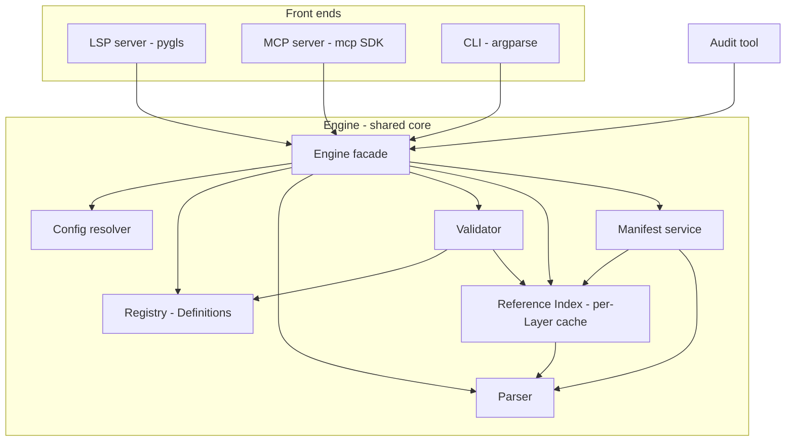
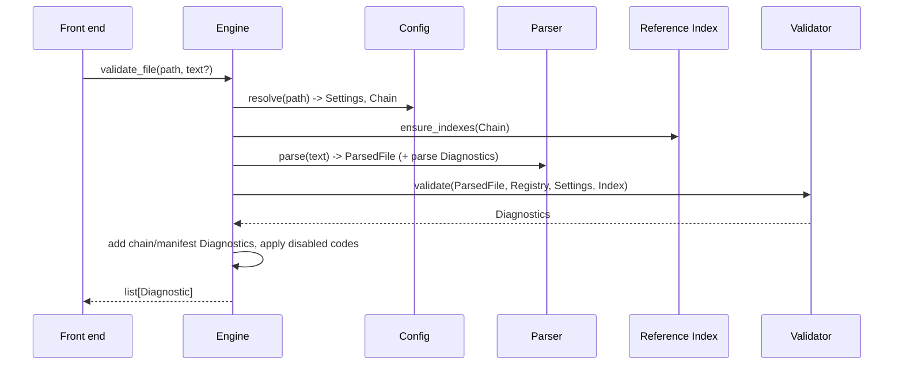

# Design Document

## Overview

`soase-validator` is a Python package that validates and assists with Sins of a Solar Empire (Sins 1) mod files without Java or Eclipse. A single pure-Python **Engine** parses mod files, validates them against declarative **Definitions** ported from zombiesrus5's Eclipse SoaSE plugin, resolves cross-file references through a layered **Reference Index**, and checks **manifests**. Three thin front ends sit on the Engine:

- an **LSP server** (diagnostics on open/save, completion, hover, go-to-definition, code actions),
- an **MCP server** (validate, complete, help, configuration, manifest tools for AI agents),
- a **CLI** (`init`, `config`, `manifest check`, `manifest sync`, `audit`, `versions`).

The package targets Python 3.14+, runs offline on Windows, macOS, and Linux, and is installed and run with `uvx --from git+https://github.com/<owner>/soase-validator <entry-point>`. No PyPI publication is needed.

### Key Design Decisions

| Decision | Rationale |
| --- | --- |
| One Engine, three front ends | Requirement 9.6 demands identical Diagnostics from LSP and MCP. Front ends only translate types. |
| Definitions as bundled data (JSON), not code | Requirements 1.2 and 12.2 want rules updatable independently of the Engine. The original XML Definitions are converted to JSON by a build-time script. Loading JSON avoids an XML dependency and is fast. |
| Hand-written tolerant parser | Requirement 2.8 requires Diagnostics for the parsed portion of a broken file. Parser generators handle error recovery poorly for this line-oriented, indentation-structured format. |
| Pure functions at the core | Parser, value checks, version gating, manifest parsing and sync planning are pure and deterministic, which makes them suited to property-based tests. |
| Per-Layer index cache keyed by file signature | Requirement 14.10: reuse a Layer's index across Projects sharing that Layer. |
| Unknown keys are errors | Matches the original plugin (Decisions 1). Definition gaps are therefore found through the Rebellion 1.98 audit tool (Requirement 13). |
| Dependencies kept small | `pygls>=2.1,<3` and `lsprotocol>=2025.0.0` for LSP, `mcp>=2.3,<3` (the official SDK) for MCP, `platformdirs` for the user config path, `hypothesis` and `pytest` for tests, `ruff` for lint. The latter four are resolved at project creation using ranges that include the current release. |

### Research Findings

- **LSP**: `pygls` is the standard Python LSP framework. The current release is 2.1.1, built on `lsprotocol` 2025.0.0, and supports `textDocument/didOpen`, `didSave`, `didClose`, completion, hover, definition and code action handlers, plus `workspace/didChangeConfiguration` and file-watch registration. Dependency ranges are `pygls>=2.1,<3` and `lsprotocol>=2025.0.0`. Source: [pygls documentation](https://pygls.readthedocs.io/).
- **MCP**: the official Python SDK is `mcp`, whose current release is 2.3.0 (the 1.x line ends at 1.30.0 and uses the older `FastMCP` name). In 2.x the server class is `MCPServer`, imported with `from mcp.server import MCPServer`, and tools and resources are registered with `@mcp.tool()` and `@mcp.resource("uri/{param}")`. The package requires Python 3.10 or later, so it is compatible with Python 3.14. The dependency range is `mcp>=2.3,<3`. All MCP SDK usage stays in one module (`mcp_server/app.py`) to keep the front end thin. Source: [mcp on PyPI](https://pypi.org/project/mcp/).
- **uvx from GitHub**: `uvx --from git+https://...` builds the package from `pyproject.toml`, so the project declares `[project.scripts]` entry points and `requires-python = ">=3.14"` (Requirement 10). Definitions are shipped as package data.
- Content was rephrased for compliance with licensing restrictions.

## Architecture



### Package Layout

```
soase-validator/
  pyproject.toml
  README.md
  LICENSE
  CREDITS / NOTICE (third-party attribution)
  src/soase_validator/
    __init__.py
    engine/
      facade.py          # Engine class: the only API front ends use
      model.py           # dataclasses: Diagnostic, Position, Range, enums
      versions.py        # GameVersion, gate-token evaluation
      config.py          # Settings resolution, soase.json, user file, env
      chain.py           # Layer, Chain, extends resolution, cycle detection
      registry.py        # Definition loader and Registry
      parser.py          # TXT/TXT2 tolerant parser -> ParsedFile
      validator.py       # structural and value validation
      primitives.py      # Boolean/Integer/Decimal/Color/... checkers
      refindex.py        # per-Layer indexes, merged lookup
      layercache.py      # on-disk and in-memory index cache
      manifests.py       # manifest rules, check, sync planning
      diagnostics.py     # code catalogue, disabling, severity mapping
      completion.py      # completion and hover computation (UI-agnostic)
    definitions/         # bundled JSON Definitions + manifest_rules.json + PROVENANCE.json
    lsp/server.py        # pygls handlers
    mcp_server/app.py    # MCP tools and resources
    cli/main.py          # init, config, manifest, audit, versions
    audit/audit.py       # audit tool
  tools/convert_definitions.py   # one-off XML -> JSON converter (not shipped at runtime)
  tests/
```

### Control Flow: Validate a File



Any unexpected exception inside `validate` is caught at the facade, logged, and the Diagnostics collected so far are returned (Requirement 11.5).

### Concurrency Model

The LSP server runs on asyncio. CPU-bound Engine calls (index builds, validation) run in a worker thread through `asyncio.to_thread`. The Reference Index is guarded by a reader/writer lock: lookups are lock-free over immutable per-Layer snapshots, and updates replace a Layer's snapshot atomically.

## Components and Interfaces

### Engine Facade

```python
class Engine:
    """Single entry point used by the LSP, MCP, CLI and audit front ends."""

    def __init__(self, *, user_config_path: Path | None = None, env: Mapping[str, str] | None = None) -> None: ...

    # Configuration
    def resolve_settings(self, path: Path, overrides: Mapping[str, Any] | None = None) -> ResolvedSettings: ...
    def effective_config(self, path: Path) -> EffectiveConfig: ...

    # Validation
    def validate_file(self, path: Path, text: str | None = None, settings: ResolvedSettings | None = None) -> list[Diagnostic]: ...
    def validate_directory(self, root: Path) -> dict[Path, list[Diagnostic]]: ...

    # Assistance
    def complete(self, path: Path, text: str, position: Position) -> list[CompletionItem]: ...
    def hover(self, path: Path, text: str, position: Position) -> HoverResult | None: ...
    def definition(self, path: Path, text: str, position: Position) -> Location | None: ...
    def field_help(self, structure: str, field: str, version: GameVersion) -> FieldHelp | None: ...
    def entity_types(self, version: GameVersion) -> list[str]: ...

    # Index maintenance
    def on_file_saved(self, path: Path) -> set[Path]: ...    # returns dependents to re-validate
    def on_layer_files_changed(self, layer: Layer) -> None: ...

    # Manifests
    def manifest_check(self, project: Path) -> list[Diagnostic]: ...
    def manifest_plan(self, project: Path, *, remove_stale: bool = False) -> SyncPlan: ...
    def manifest_apply(self, plan: SyncPlan) -> list[BackupRecord]: ...
```

### Definition Loader and Registry (Requirements 1, 12)

Definitions are bundled as JSON files in `definitions/`, one per structure family, plus `enums.json`. A converter script (`tools/convert_definitions.py`) transforms the original XML at development time; `definitions/PROVENANCE.json` records origin, author (zombiesrus5), source version, conversion date and the list of audit corrections (Requirement 12.1, 13.5).

Node types map to a tagged-union of frozen dataclasses:

```python
@dataclass(frozen=True, slots=True)
class FieldDef:
    name: str
    type: str | None             # enum name or primitive/reference validation type
    validation: str | None
    values: tuple[str, ...] | None
    required: bool
    version: str | None          # gate expression
    help: str | None
    constraint: str | None

# Also: StructureDef, IterativeFieldDef (count key + limit), ConditionFieldDef
# (selector value -> branch), StructureReferenceDef, ConditionReferenceDef, ElementRuleDef.
```

`Registry` is built once at startup and is read-only:

```python
class Registry:
    def structure(self, name: str) -> StructureDef | None: ...
    def element_rule(self, name: str) -> ElementRuleDef | None: ...
    def structure_for_extension(self, ext: str) -> StructureDef | None: ...
    def enum(self, name: str) -> EnumDef | None: ...
    warnings: tuple[LoadWarning, ...]
```

Malformed Definitions and dangling structure references produce a `LoadWarning(file, element, message)` and loading continues (Requirement 1.3). Resolution of structure references is done in a second pass so forward references work.

**Field `constraint`.** The zombiesrus5 schema has a `constraint` string on `field` (and `element_rule`). The plugin only recognised `>0` and `>=0` on `Decimal`, and no shipped Definition uses either, so those meanings are dropped. Here `constraint` carries the per-field shape of a value. The only form defined is `count=N` (N a positive integer) on a `Position` field, giving the exact number of integers. `primitives.validate_constraint(validation, constraint)` returns a message for any other use (a constraint on another type, or a malformed `count`). Each constraint added to a bundled Definition is recorded in `PROVENANCE.json` `audit_corrections` with the game version and the evidence (shapes and counts). The converter copies `constraint` from `field` and `element_rule` elements; it drops it on a repeated value of an `iterative_field` and says so in its report. Constraints in the original XML are not the audit constraints above: the XML carries none of the `count=N` values, so converting from XML would remove them.

**Corrections and the converter.** Corrections are made only in the bundled JSON and recorded in `PROVENANCE.json` `audit_corrections`. Each entry carries a `verify` list. A field check names the registry structure, the field, the expected number of matching nodes and the attributes to match (`validation`, `constraint`, and optionally `node` kind, `type`, `count_key`, `version`, `values_include`, and a `branch` of a condition field, with `selector` naming it when there are several). Other checks cover a structure's `extension`, `child_names` or `first_child`, the declared order of the gates of same-named children (`versions_in_order`) and an enumeration's `members`. Two guards keep a re-run from silently reverting them:

- `tools/convert_definitions.py` refuses to write into a directory whose `PROVENANCE.json` lists `audit_corrections`, prints the reason to stderr and exits 2, unless `--overwrite-corrections` is given. After using the flag, every correction must be re-applied by hand.
- A test checks every `verify` entry against the loaded Registry, so a reverted correction fails the suite.

### Version Gating (Requirements 3.9, 13.8)

`GameVersion` is an enum: `VANILLA`, `ENTRENCHMENT`, `DIPLOMACY`, `REBELLION_185`, `REBELLION_193`, `REBELLION_194`, `REBELLION_198`. A bare "Rebellion" maps to `REBELLION_198`. Each version has an ordered **capability set** of gate tokens it satisfies. A gate expression is a comma/space separated token list; an element is visible when any token is satisfied (matching the legacy semantics, documented in `docs/version-gates.md` per Requirement 13.8).

```python
def gate_allows(gate: str | None, version: GameVersion) -> bool: ...
```

`REBELLION_198` starts from the `REBELLION_194` capability set. The audit may add or remove tokens via an `overrides` section in `definitions/versions.json`, each with evidence. Tokens that cannot be verified are flagged `unverified` and shown by `versions`. Non-198 versions are all labelled `unaudited`.

**File ruleset from `SinsArchiveVersion` (Requirements 2.16, 2.17, 3.9.1 to 3.9.3).** Archive versions are backwards compatible and tell the Engine which ruleset a file uses. `ARCHIVE_VERSIONS` maps 185, 193 and 194 to `REBELLION_185`, `REBELLION_193` and `REBELLION_194` (the Reference Root carries 193 and 194). `VERSION_ORDER` ranks the versions `VANILLA < ENTRENCHMENT < DIPLOMACY < REBELLION_185 < REBELLION_193 < REBELLION_194 < REBELLION_198`; 1.98 ranks last because it starts from the 194 set. `effective_version(archive_version, project)` returns the project version for `None` (TXT files), an unknown number or a level newer than the project; the level itself for an older known level; and the project version when the level is 194 and the project is 1.98, so 1.98 overrides still apply to the 194-labelled base game files. `is_newer_than`, `archive_level` and `introduced_in(gate)` (the oldest Rebellion version satisfying a gate, for hints) are pure helpers in `versions.py`.

### Parser (Requirement 2)

The parser is a tolerant, line-oriented scanner producing a tree of `Node`s with exact source positions.

```python
@dataclass(frozen=True, slots=True)
class Span:                      # in engine/model.py; zero-based
    line: int; col: int; end_line: int; end_col: int

@dataclass(frozen=True, slots=True)
class StringValue:
    text: str                    # between the quotes, may be empty
    terminated: bool = True      # False when the closing quote is missing

@dataclass(frozen=True, slots=True)
class NumberValue:
    raw: str                     # exactly as written
    value: int | float           # int when there is no decimal point or exponent
    # property is_integer: True when value is an int

@dataclass(frozen=True, slots=True)
class BoolValue:
    value: bool                  # TRUE / FALSE only

@dataclass(frozen=True, slots=True)
class ListValue:
    items: tuple[NumberValue, ...]
    separator: str = ","         # "," comma separated, " " whitespace separated (2+ items)

@dataclass(frozen=True, slots=True)
class HexValue:
    raw: str                     # bare hex token that is not a number, e.g. "ffffffff"

Value = StringValue | NumberValue | BoolValue | ListValue | HexValue

@dataclass(slots=True)
class Node:
    key: str                     # empty for a keyless row (a line starting with "[")
    key_span: Span
    value: Value | None = None   # None for block keys
    value_span: Span | None = None
    children: list[Node]         # nodes nested under this key
    parent: Node | None          # excluded from repr and equality
    extent: Span                 # key start to the end of the last descendant
    indent: int = 0              # indentation width of the key's line

@dataclass(slots=True)
class ParsedFile:
    header: str | None           # "TXT" | "TXT2" | None when missing
    nodes: list[Node]
    diagnostics: list[Diagnostic]
    complete: bool = True        # False when recovery was needed
```

The parser keeps the raw token text in `NumberValue.raw` and `HexValue.raw`, so the primitive checkers decide what a token means (a Color `00000000` is a `NumberValue`; `ffffffff` is a `HexValue`).

Algorithm:

1. Read the first non-empty line. If it is not `TXT` or `TXT2`, emit `SOASE-P001` (error, line 1) and continue parsing as if a header were present (Requirement 2.7, 2.8).
2. For each subsequent line, measure the indentation (the length of the leading run of tabs and spaces, with each tab or space counted as one unit), then split the rest into a key and an optional value. The key is everything before the first run of tabs or spaces, so it may contain colons (Requirement 2.2). Classify the value as a quoted string (`"..."`, possibly empty, with an unterminated quote recovered to end of line plus `SOASE-P003`), a number, `TRUE`/`FALSE`, a bare hexadecimal token that is not a number (`HexValue`, used for colors), a bracket list, or none. A line whose first non-blank character is `[` is a keyless row: a node with an empty key and a list value.
3. The tokenizer reads bracket lists into a `ListValue` of numbers with a recorded `separator`: comma separated (`[ 234 , 219 ]`, `[9, 99, 999, 99]`) or whitespace separated (`[ 0.000000 0.100000 0.000000 ]`). A list that contains a comma is comma separated; otherwise items are split on whitespace.
4. Block extent is decided by indentation alone, compared relatively with an indent stack as in Python. A key with no value opens a block, and its children are the following lines whose indentation is wider than the block key's indentation. The block ends at the first line whose indentation is not wider than the block key's. Spaces are accepted silently with no Diagnostic. Mixed tabs and spaces are compared by leading-whitespace length, with a tab counted as one unit, so a line is never rejected for its indentation characters. Nesting levels are therefore defined by the stack of widths seen so far, not by absolute widths.
5. A count key such as `starCount N` is an ordinary key-value node. The N repeated blocks (for example `star`) or repeated value lines (for example `recommendedGameType "FFA"`) that follow are sibling nodes with the matching name. The validator compares the count with the number of repeats (Requirement 2.5, 3.7); the parser does not depend on the count to find block extents.
6. Unrecoverable lines produce `SOASE-P002` and are skipped so that later lines are still parsed. A line is unrecoverable when its value is none of the forms in step 2 (including a malformed bracket list), or when its key contains `=`. The only accepted `=` shape is `key = "value"` (whitespace on both sides of the `=`, quoted value), which is read as `key "value"`; `key= "v"`, `key ="v"`, `key = 5` and a bare `=` are all `SOASE-P002`. Any text after a complete quoted value on the same line, stuck to the closing quote or whitespace separated, is also `SOASE-P002` (user decision, see Verified format facts). A skipped line can cause follow-on validator diagnostics: for a `.str` `Value` line the entry then has no `Value`, so task 5.4 may report a missing required field for it and should account for this.
7. `SinsArchiveVersion` is validated only in `TXT2` files, must be an integer, and gives an informational `SOASE-P004` only when it is unknown or newer than the Project's Game Version; a known number not newer (185, 193, 194 against 1.98) gives nothing (Requirements 2.10, 2.11, 2.16, 2.17). `parse(text, file, game_version=None)` takes the Project's Game Version for this check (None skips it); the parser stays pure. A `TXT` file never gets a missing-version error. Galaxy `TXT` files carry `versionNumber 193` (126 of 126 files); it is an ordinary key, defined as the first `Galaxy` field, and selects no ruleset. The plugin reads that line as a header and the value `193` selects its TXT2 definition set; the choice is not modelled because every audited file has `193`.

Parsing is exposed as `parse(text: str) -> ParsedFile` and a printer `format_tree(parsed) -> str` used only in tests for round-tripping. The scanner is format-agnostic and needs no per-extension options.

#### Verified format facts

These were checked against the Rebellion 1.98 reference set and drive the parser and the tests' generators:

- Entity files start with `TXT2`, then `SinsArchiveVersion 194`, then `key value` lines. Galaxy and manifest files start with `TXT`; galaxy files carry `versionNumber 193` instead of `SinsArchiveVersion`.
- Nesting uses tab indentation in the base game files, and those files contain no space-indented lines. Parsing does not require tabs: spaces are accepted without a Diagnostic and block extent is decided by relative indentation width.
- Keys may contain colons, for example `Level:0 0.000000`.
- Comma separated integer lists: `pos [ 234 , 219 ]` has 2 items; `area`, `pixelBox` and `mainViewIconAreaOffsetFromCenter` have 4 items. Spacing varies (`[ 9 , 99 ]` and `[9, 99, 999, 99]`). Uses by extension: `.brushes` 10022 (4 items), `.galaxy` 4014 (2), `.entity` 582 (2) plus 81 (4), which are the 14699 uses the Definitions cover (the Primitive rules total below). `.window` (697, 4 items) and `.screen` (11, 4 items) use the same shape but have no Definition, so they are parsed and never validated.
- Whitespace separated decimal lists: particle `Position`, `MeshParticleRotationAxis`, `Direction`, `Point`, `AxisOfRotation` and `AxisOrigin` are always 3 items, for example `[ 0.000000 0.100000 0.000000 ]` (7876 uses). Every parsed use is in `.particle`. The Coordinate and Orientation fields in `mesh.json` describe the binary `.mesh` format, which is out of scope and never parsed.
- `Orientation` (particle, 3625 uses) is a header with no value whose children are keyless rows, each a whitespace separated list of 3 decimals (10875 rows, always 3 per header).
- Colors are bare hexadecimal tokens, not quoted and not bracketed: 8 digits (4109 lowercase uses plus one uppercase use in `.constants`), plus a lone `0` (94 uses on `cloudColor`, `glowColor`, `ringColor` and `corona*Color`), plus 6 digit (3) and 4 digit (1) tokens (`corona*Color`, `dustCloudColor`). The parser yields `NumberValue` for all-digit tokens (`0`, `00000000`) and `HexValue` otherwise. `.color` files also use mixed-case 8 digit tokens and a `0x` prefixed form (13 lines); `.color` is not validated and `0x` does not occur in any validated Color field.
- Booleans are `TRUE` or `FALSE` only; no other spelling or case occurs.
- Numbers: integers (`42`, `-3`), decimals with a digit before the point (six places is the usual form but 1 to 9 places occur), and decimals with no digit before the point (`.5`, `-.111111`, about 210 uses). A leading `+`, exponents and a trailing point do not occur. Fields defined as `Integer` often hold decimals (for example `colonizeChance`, `priority`, `playTime`) and `Decimal` fields often hold integers.
- The form `key = "Value"` occurs in `.constants` (22 lines, all `*DefName` keys defined as entity references), with whitespace on both sides of the `=` and a quoted value. The parser reads it as the same key and value as `key "Value"` (spans cover the key and the quoted value, not the `=`). Only that shape is accepted: an unquoted value, no space after `=` (`key ="v"`), a bare `=`, or a key that contains `=` (`key= "v"`) gives `SOASE-P002`. No key in the reference files contains `=`. The plugin reached a different result by replacing every `=` in a line with a space.
- Lines the parser reports as `SOASE-P002` in the Rebellion 1.98 reference files (3068 `TXT`/`TXT2` files, 21 lines): malformed lists in `.window` (2 lines), `0x`-prefixed color tokens in `.color` (13 lines) and the 6 trailing-text lines below (5 `.str`, 1 `.window`). The count was 15 before the trailing-text rule and the same before and after the `=` rule.
- **Text after a complete quoted value (user decision):** the parser reports any text after the closing quote of a quoted value as `SOASE-P002` (line skipped, recovery continues), both text stuck to the quote (`"text""`, `fontId "ButtonLabel"new`) and whitespace separated text (`a "x" "y"`, `a = "v" tail`). Six base-game lines have this shape: 5 in `.str` (a doubled closing quote) and 1 in `.window` (letters after the closing quote). They are flagged by design decision because they are typos, which raises the reference total to 21 `SOASE-P002` lines (`.str` 5, `.color` 13, `.window` 3). An unterminated quote is still `SOASE-P003`. A skipped `.str` `Value` line may lead to follow-on validator diagnostics (for example a missing required field) once task 5.4 exists.
- Quoted strings may be empty (`""`), and decimals are written with six places (`0.000000`).
- **Written form of enumeration members:** `TRUE` and `FALSE` members are unquoted booleans (266 uses, never quoted), word members are quoted strings (33645 uses, never bare), and numeric members are either an unquoted number (155 uses) or a quoted string (12 uses).
- **Empty reference names:** an empty name means "none" in Brush, Entity, Mesh, Particle, Sound, StringInfo and GalaxyTemplate reference fields (over 15000 uses) and is never resolved.
- **Iterative fields in the bundled Definitions:** 642 in total. Exactly 2 (particle `NumEmitters` and `NumAffectors`) are sequences of sibling lines, accounting for 8546 repeats in 872 particle files. 5 iterative fields share the repeat key `SoundID` in each entity structure and are told apart only by the count line before the run.
- Count keys (`starCount`, `planetCount`, `triggerCount`, `recommendedGameTypeCount`, `NumResearchPrerequisites`) precede that many repeated blocks or value lines, and may be zero.
- **Indentation of counted repeats:** repeats sit either at the count line's level (14,989 runs, plus 1,669 particle sibling sequences) or exactly one level deeper (174 runs). No run uses another offset and no run mixes the two styles. Anything else is `SOASE-V080`.
- **Lines deeper than a value line (`SOASE-V080`):** over the Rebellion 1.98 Reference Root the rule reports 132 findings in two `.galaxy` files (70 and 62), one per planet whose `owner` is written one level shallower than the planet's other keys, with no follow-on findings (see Validator, shallow members of a counted repeat). The previous-line filter (Requirement 3.16) keeps out the 16 random-map `.galaxy` files where `starCount` is followed by a one-level-deeper `star`; the `Galaxy` Definition places that run at the top level of the `useRandomGenerator TRUE` branch as well as inside `randomizerParams` (6 files). A `.randomeventdefs` run of `race`/`buff` line pairs is declared as a repeat, so it gives no finding. Files with no root Definition get no `SOASE-V080`, so about 25 whitespace cases in `.window` files are not covered.

### Validator (Requirement 3)

`validate(parsed, ctx) -> list[Diagnostic]` where `ctx` bundles Registry, GameVersion, Settings and a `ReferenceLookup`.

Steps:

0. **Choose the file's version** (Requirements 3.9.1 to 3.9.3): in a `TXT2` file, read the top-level integer `SinsArchiveVersion` and compute `effective_version(archive, ctx.version)` once. Every gate check (`allowed`, memoised per walk) uses it: structures, fields, enumeration members, `entityType`, required fields, and the order, duplicate and indentation passes. When a key is unknown but defined for `ctx.version` and gated out for the file's version, the `SOASE-V020` message is `'x' was introduced in <version>; this file is SinsArchiveVersion <n>`.
1. **Select the root structure**: by file extension; for `.entity`, read the `entityType` value, check it against the version-filtered enumeration (error `SOASE-V010` if unknown) and choose the structure from it (Requirements 3.1, 3.2).
2. **Walk nodes against the structure**, using a `StructureCursor` that tracks which keys of the current structure have been seen:
   - Unknown key → `SOASE-V020` on the key (Requirement 3.6).
   - Known field → check value by validation type (Requirement 3.3, 3.4).
   - `condition_field` → evaluate selector, then continue with the selected branch only (Requirement 3.8).
   - `iterative_field` → compare count to `limit` and to the number of repeated blocks (`SOASE-V030`, Requirement 3.7).
   - After a block ends, any `required` field not seen yields `SOASE-V040` on the enclosing block (Requirement 3.5).
   - **Declared order and duplicates (Requirements 3.11 to 3.13).** The cursor gives every active Definition node its index in declared order: gate-filtered nodes, the selected `condition_field` branch placed immediately after its selector in branch declaration order, and an iterative field's count line plus its run of repeats at the field's declared position (for flat sequences such as particle `EmitterType` + `EmitterContents`, the selected branch precedes the other children). A plain key or count line used a second time in a block is `SOASE-V070` on the later key (message gives the first line) and takes no position. Unknown keys (`SOASE-V020`) take none either. Repeats inside a counted run are never duplicates, so two iterative fields sharing a repeat key (`SoundID`) are fine. Of the remaining keys, a longest strictly increasing run of declared positions is treated as in order and every other key gets one `SOASE-V060` ("must come before/after 'X'", `X` being the nearest in-order neighbour in declared order). Rationale: the plugin's structure validator walks Definitions in order by default; resyncing on a longest in-order run means one misplaced key gives one Diagnostic instead of one per following key. Evidence: over the Rebellion 1.98 Reference Root (3066 text files, the two galaxy files with the indentation artefact excluded) no key breaks the declared order and one `.entity` file repeats `buffType` in an `Ability` (lines 6 and 26 of that file). Task 5.9 reviewed it: the first is in the selected `buffInstantActionType` branch and the second in the selected `aiUseTime` branch (`OnlyWhenManyTargetsInCombatDoNotHaveBuff`), both correct Definitions, so the duplicate rule is what flags it and the finding stays open. The Buff `instantActionTriggerType` gap is a Definition fix (`AnyInstantActionWithTriggerTypeDone`).
   - **Shallow members of a counted repeat (owner artefact, Requirements 3.5 to 3.7).** Block extents come from indentation and the parser attaches a line to the nearest shallower header, so a planet's `owner` written at the planet's own indentation, and the planet lines written after it, become siblings of the planet in the star. `_repeat_run` therefore assigns to a block repeat each following sibling that (a) sits at the repeat's indentation, (b) has a value, (c) is not defined by the enclosing block (not a field, count key or repeat key there) and (d) is a field or count key of the repeat block, together with the siblings deeper than it that follow. The repeat block validates them as its own members, so they produce no `SOASE-V020`, `SOASE-V030`, `SOASE-V060` or `SOASE-V070`, and the run continues with the next `planet`. The indentation pass still reports the shape once as `SOASE-V080` (same code, severity and message), on the first deeper line after the shallow line. A key that fails any condition keeps its current result, for example an unknown key next to the shape stays `SOASE-V020`, and a correctly indented `owner` is untouched. Evidence: over the Rebellion 1.98 Reference Root the two galaxy files give 132 `SOASE-V080` findings (70 and 62) and no other finding; every other file's findings are unchanged.
   - **Second `buffType` of an Ability (Requirements 3.12, 3.13).** The Ability Definition declares `buffType` in the top-level block and again in the `aiUseTime` branch `OnlyWhenManyTargetsInCombatDoNotHaveBuff`, and the cursor indexes one position per key name, so the second use would be a duplicate. `_is_ai_use_time_buff_type` is a named exception to `SOASE-V070` with three conditions: the block belongs to the `Ability` structure, the key is `buffType` and it is the second `buffType` of the block, and an `aiUseTime` line with that value comes before it. The second use takes no declared position. A third `buffType`, a second one before the `aiUseTime` line, one under any other `aiUseTime` value and every other duplicate key stay `SOASE-V070`. Evidence: over the Rebellion 1.98 Reference Root exactly one Ability file has two `buffType` lines and that `aiUseTime` value; it is the only `SOASE-V070` finding in the whole Reference Root, so the Reference Root has none after the exception.
   - **Unexpected indentation (Requirements 3.14 to 3.16).** After the walk, a separate pass visits every node in source order. A line deeper than the line right before it is expected only when that line is a block header (no value), or is the count line of an iterative field and the deeper line is the first repeat of its run, exactly one level deeper. Otherwise `SOASE-V080` goes on the deeper line's key and names the previous line as probably under-indented, but only when the previous line is known (option A): a plain field, count line or repeat matched in its block (a count mismatch on the count line does not change this), or an unknown key that is a field of the repeat block ending right before it at the same indentation, which applies only to a repeat that no count line places (a placed repeat takes such a line as one of its members, see the next item). Other unknown keys, repeats without a count line, list rows and every line inside a block no Definition matched are skipped. Repeats of one run must share the first repeat's indentation, which is the count line's level or one deeper; the first repeat that breaks it gets one `SOASE-V080` (later repeats of the run are judged only by this check). The pass changes neither the tree nor other findings, so `SOASE-V020`/`SOASE-V030` for the same lines remain. Files without a root Definition (for example `.window`) are not checked. Evidence and the Reference Root result are in Verified format facts.
3. **Version gates**: every structure, field and enum value passes through `gate_allows` before it is considered defined (Requirement 3.9).
4. **Numeric strictness** settings adjust `Integer` and `Decimal` checking (Requirement 3.10): `integer_strict` rejects values with a decimal point; `decimal_allow_integer` controls acceptance of integer-form decimals.

`primitives.py` exposes one pure function per primitive type with signature `check_<type>(raw: Value, prefs: NumericPrefs, constraint: str | None = None) -> PrimitiveResult`. `constraint` is the field's `constraint` string from the Definition (`FieldDef.constraint`). `check_orientation` takes the header `Node` instead of a value, because an Orientation is a value-less header whose children are the rows. `validate_constraint(validation, constraint)` checks a constraint at load or test time; `check_position` raises `ValueError` for a malformed one. Reference types are not primitives; they call `ReferenceLookup.resolve(kind, name)`.

#### Primitive rules and evidence

The Rebellion 1.98 reference files are the authority. The checkers accept exactly the shapes below and reject the rest. Counts are uses in the reference files (shapes and counts only; no game content is stored).

1. **Color**: an unquoted token of exactly 8, 6 or 4 hex digits in any letter case, or a lone `0`. Every digit is checked. A `0x`/`0X` prefix, a quoted value and any other length are rejected. The raw token text is checked, because the parser yields `NumberValue` for all-digit tokens and `HexValue` otherwise. Evidence: 4208 uses in 34 contexts (8 digits 4110, `0` 94, 6 digits 3, 4 digits 1).
2. **Position**: a bracketed, comma separated list of integers (negatives allowed, no decimals). The item count comes from the field's `constraint` `count=N`: 2 for `pos` (`.galaxy` star and planet, `researchWindowLocation`), 4 for `pixelBox`, `area` and `mainViewIconAreaOffsetFromCenter`. Evidence: 14699 uses in 13 contexts, each field always one count (pos 4596 uses, pixelBox 10022, area 77, mainViewIconAreaOffsetFromCenter 4). These counts cover only extensions that have a Definition; the 697 `.window` and 11 `.screen` lists in Verified format facts are not included. A Position field with no `constraint` has its shape checked and its count left unchecked, because the survey did not reach it (see task 5.9).
3. **Coordinate**: a bracketed, space separated list of exactly 3 numbers; each item may be in integer or decimal form. All reference uses are six-place decimals, and the integer form is accepted by user decision to match the zombiesrus5 plugin, which parses items with `BigDecimal`. **Orientation**: a header with no value and exactly 3 keyless child rows, each a Coordinate. Evidence: Coordinate 7876 uses in 11 contexts, Orientation 3625 uses in 3 contexts (10875 rows). Every parsed use is in `.particle`. The Coordinate and Orientation fields in `mesh.json` belong to the binary `.mesh` format, which is never parsed, so they have no text evidence and are out of scope. The integer-item leniency for Coordinate is a user decision (the plugin parses items with `BigDecimal`); no reference use has an integer item.
4. **Integer** accepts the decimal form and **Decimal** accepts the integer form by default; `integer_strict` and `decimal_allow_integer` keep their meaning. Evidence: Integer fields hold decimal forms in 15 contexts (`dec6` 199 uses), Decimal fields hold integer forms in 84 contexts (666 uses). Integer fields also hold `dec1` (106 uses) and `leading-dot1` (22 uses) forms. Boolean fields hold `TRUE` or `FALSE` only: 68956 uses in 228 contexts.
5. **Number form** (Integer, Decimal, Coordinate items): exponents, a leading `+` and a trailing `.` are rejected; a leading-dot (`.5`, `-.5`) and negatives are accepted. None of the rejected forms occurs; leading-dot occurs about 140 times.
6. **Parser**: the `key = "value"` form is read like `key "value"`, and a key containing `=` is `SOASE-P002` (see Verified format facts).
7. **Definition correction**: `GroupType.condition` `param` for `PlanetOwnerIsMilitiaWithChance` and `NoPlanetOwnerWithChance` was `Decimal` but all 15 real uses are quoted (two distinct values, 7 and 8 uses), so it is now `Any`. See `PROVENANCE.json`.
8. **Shape parameters live in the Definitions**, on the field, in `constraint` (see Definition Loader and Registry). A malformed `constraint` makes `check_position` raise `ValueError`; the validator (task 5.4) reports it once at load as `SOASE-D001` through `validate_constraint`, so the checker never sees one in normal use.
9. **Iterative fields are counted repeats of sibling lines** (task 5.4, not part of primitives): see below.
10. **`.galaxy` planet `owner`** takes the fixed values `""`, `PlanetOwner`, `NoOwner`, `Pirate` and `RandomMilitia`, or a `designName` declared by a top-level `player` block of the same file. The Definition field carries `values_from` (`player.designName`, a dotted key path from the file root); the validator collects those values over the whole file before checking, because the `player` blocks follow the planets. Matching is case-sensitive. A file with no `player` block accepts only the fixed values. Evidence over the Rebellion 1.98 Reference Root (126 `.galaxy` files, 22 without a `player` block): 3923 `owner` uses; 3217 empty; 548 equal to a declared name; 100 fixed values (`PlanetOwner` 81, `NoOwner` 13, `Pirate` 4, `RandomMilitia` 2); 58 in 6 files name `Player3`, `Player5` or `Player8` without declaring it, which are bad base game data reported as `SOASE-V050`. The files without a `player` block use no `owner` other than empty. Declared names include `Player0` to `Player9`, `NewPlayer`, `NewPlayer0` to `NewPlayer9`, `P0` to `P5` and `0` to `5`. The XML member list (`Player-0` to `Player-9`, `NewPlayer*`, `Player0` to `Player9`, digits, `Pirate`) is replaced by the rule above; `PlanetOwner`, `NoOwner` and `RandomMilitia` are not in it. `.galaxyScenarioDef` `owner` is a `GalaxyDesign` reference with no member list.

**Where this is stricter than the zombiesrus5 plugin.** The plugin checks only the first 6 characters of an 8 digit Color and 5 of a 6 digit Color, blanks every quote and `=` before checking a value (so a quoted Color or number passes), does not count Position or Coordinate items, and parses numbers with `BigDecimal`, which accepts exponents, a leading `+` and a trailing `.`. This tool checks every digit, does not strip quotes, enforces the counts above and rejects those number forms. None of the plugin-only forms occurs in the reference files.

**Iterative fields (task 5.4).** An `iterative_field` is driven by a count line `Name N` followed by N repeats, and a repeat may be a sequence of sibling lines rather than a single named block. Example: a `.particle` file has `NumEmitters N` followed by N repeats of an `EmitterType "x"` line plus an `EmitterContents` block, all siblings. The plugin models this as one iteration containing a `condition_field` (the selector line) and a structure reference (the block); the validator must match repeats as a sequence of sibling nodes in the order the iteration's children are declared, and compare the number of complete sequences with the count (`SOASE-V030`). Block extents still come from indentation alone, never from the count.

### Reference Index and Chain (Requirements 4, 14)

```python
@dataclass(frozen=True, slots=True)
class Layer:
    name: str
    path: Path
    kind: Literal["game", "mod", "project"]
    status: Literal["ok", "missing", "unusable"]

@dataclass(frozen=True, slots=True)
class Chain:
    layers: tuple[Layer, ...]          # lowest first; project last
    complete: bool
    problems: tuple[ChainProblem, ...]
```

**Chain resolution** (`chain.py`):

1. Start from the project's configured `layers` list (paths or aliases, expanded through the user-level alias table) (Requirement 14.1, 14.7).
2. For each Layer directory that has its own `soase.json` with `extends`, splice the parent Chain beneath it, depth-first. A visited-set detects cycles and raises `ChainCycleError` naming the Layers, reported as `SOASE-C010` (Requirement 14.6.1).
3. De-duplicate, keeping each Layer at its lowest position (Requirement 14.6.2).
4. Append the Project Mod Root as the implicit top Layer unless listed (Requirement 14.2).
5. Mark Layers `missing` if the path does not exist and `unusable` if a game Layer does not look like game data. A directory looks like game data when it contains at least one subdirectory named in the top-level directory list below, compared case-insensitively; `GAME_DATA_DIRECTORIES` in `chain.py` is the single definition. A Layer need not hold every directory, so one directory is enough. One warning per such Layer: `SOASE-C020` (Requirement 4.6.3, 14.9).
6. `complete` is true exactly when no declared (non-Project) Layer is `missing` or `unusable`. The game Layer is optional, so a Chain with no game Layer and every declared Layer `ok` is complete, and so is a Project with nothing configured (Requirement 4.6.1).

The Chain uses the Project's single Game Version (Requirement 14.8). It is built only from configuration, never from `EnabledMods.txt` (Requirement 14.17).

**Per-Layer index** (`refindex.py`, `layercache.py`):

```python
@dataclass(frozen=True, slots=True)
class LayerIndex:
    layer: Layer
    signature: str                       # hash of (relpath, size, mtime_ns) of indexed files
    names: Mapping[RefKind, Mapping[str, Entry]]   # key = casefolded name
    manifests: Mapping[ManifestType, ManifestData]
    files: Mapping[str, Path]            # casefolded relative path -> absolute path
```

- `RefKind` covers entities, brushes, string IDs, sounds, sound files, meshes, particles, textures, explosions, galaxy designs, galaxy templates, and orbit body types (Requirements 4.1, 4.9).
- Only the top-level game data directories (see Top-level directories) and files directly in the Layer root are scanned. Directories starting with `.` and VCS directories (`.git`, `.svn`, `.hg`) are skipped (Requirement 14.4.1).
- Each Layer index is built independently, cached in memory keyed by `(resolved path, game version, language)` and persisted as a pickle-free JSON file in the platform cache directory. The language is part of the key (and of the stored file, which is rejected when it names another language) because it decides which localized files define names. The cache is reused across Projects sharing a Layer and language and is invalidated when the signature changes (Requirement 14.10).
- Incremental update: on save, only the changed file is re-parsed and its names replaced in the owning Layer's index (Requirement 4.7). Changing the Game Version rebuilds all indexes (Requirement 4.2.1).

**Merged lookup** (`ChainIndex`): resolves `resolve(kind, name)` by casefolding the name and scanning Layers from highest to lowest, returning the first hit as `Resolution(layer, entry)` plus `overrides: Layer | None` for the next lower hit (Requirements 4.3, 4.4, 14.5, 14.12). Name sets for manifest-governed kinds are limited to names listed in the manifest selected by Requirement 14.4 (see below).

**Incomplete chains**: when `Chain.complete` is false, `ReferenceLookup.resolve` returns `Unknown` rather than `NotFound`, so the validator emits no unresolved-reference diagnostic. The Engine then adds one informational `SOASE-C030` per validated file, naming the missing or unusable declared Layers and how to configure them; it is not emitted for a complete Chain, including one with no game Layer. It is suppressible with `suppress_limited_reference_notice` (Requirement 4.6.2, 4.6.5). Reference completions use only names from usable Layers (Requirement 4.6.4).

**File references** (Requirement 4.9): kinds that resolve to files (Texture, SoundFile, Mesh, Particle and any other file-reference kind) are answered from `LayerIndex.files` by existence only. The lookup scans Layers from highest to lowest and compares the relative path case-insensitively (Requirement 4.4). The referenced file's content is never read or validated. An incomplete Chain gives `Unknown`, so no diagnostic is emitted.

Per-kind rules, from the Rebellion 1.98 Reference Root survey and, for Texture, a mod project that ships textures (names are compared casefolded; none of these folders has subfolders):

| Kind | Folder | Extensions tried | Name in files | Base-game names with no file |
| --- | --- | --- | --- | --- |
| SoundFile | `Sound`, or `Localizations/<language>/Sound` (see Sound and String layouts) | `.ogg` | includes the extension (`.sounddata`); a name without it also resolves | 0 of 1579 |
| Mesh | `Mesh` | `.mesh` (on disk `.MESH`) | no extension in `.entity`, `.asteroidDef`, `.skyboxbackdropdata`; with extension in `.particle` only | 1 (a `.particle` value) |
| Particle | `Particle` | `.particle` | no extension | 1 of 627 in `.entity` (a malformed value) |
| Texture | `Textures` (flat) | `.dds`, `.tga` | no extension in `.brushes`, `.entity` and most of `.skyboxbackdropdata`; `.tga` or `.dds` in `.particle`; absolute paths in `.particle` | not determinable: the Reference Root holds no image files |

A name that already ends with one of the kind's extensions is not extended again. `FileReferenceRule` holds a tuple of extensions, the referencing file types whose names may carry an extension, and whether any extension names the exact file.

**User decisions (task 8.1)**:

1. Texture existence: the folder is `Textures` (flat). A name without an extension resolves when `Textures/<name>.dds` or `Textures/<name>.tga` exists, compared case-insensitively. A name with an extension matches that file exactly. `Textures` is one of the top-level directories below.
2. Absolute Texture paths (a drive letter or a path separator, as seen in `.particle` `textureName`) are skipped silently: they are neither resolved nor reported. An empty name stays "none" and is not resolved.
3. A Mesh value carries the `.mesh` extension only where the evidence shows it (`.particle`); in every other file type a Mesh name has no extension, so `Ship.mesh` does not resolve there. `ReferenceLookup.resolve` and `find_file` take an optional `file_extension` argument, the referencing file's extension, to select the form.
4. The malformed Particle value in `.entity` (a tab followed by `effectName` and a trailing space) is not special-cased; the normal unresolved diagnostic applies.

`MeshPoint` is not a file and stays shape-only.

**Top-level directories** (user decision, task 8.3): the game data directories are `ConvertXSI`, `Galaxy`, `Galaxy Forge`, `GameInfo`, `Launcher`, `Localizations`, `Mesh`, `Particle`, `Particle Forge`, `PipelineEffect`, `TextureAnimations`, `Textures` and `Window`. Older game versions, and the Rebellion 1.98 Reference Root, also have `Sound` and `String` as independent top-level directories (and `Font`); in the Localizations layout `Sound` and `String` live inside `Localizations`. Both organisations are acceptable. A mod or base-game Layer need not contain every directory, because the game falls back to lower Layers for the missing ones. The Reference Index scans exactly these directories (each with its subdirectories) plus the files directly in the Layer root, and a game Layer is usable when it holds any one of them. `GAME_DATA_DIRECTORIES` in `chain.py` is the only definition of the list; `Font`, `Sound` and `String` are its legacy entries.

**Name sources** (`NAME_SOURCES` in `nameindex.py`, task 8.3). A name of a named kind is defined by a block of a defining file (top-level unless the rule gives a container path); the Reference Root survey confirms each rule. Names are compared casefolded and the highest Layer wins.

| Kind | Defining files | Block(s) | Name key |
| --- | --- | --- | --- |
| Entity | `.entity` directly in `GameInfo` | the file itself | the file stem |
| Brush | `.brushes` anywhere in the scanned directories | `brush` | `name` |
| StringInfo | any `.str` directly in `String` (legacy layout) or directly in `Localizations/<language>/String` for the configured language and for `en` | `StringInfo` | `ID` |
| Sound | `.sounddata` directly in `GameInfo` | `effect`, `music` | `name` |
| Explosion | `.explosiondata` directly in `GameInfo` | `explosionEffectGroup` | `groupName` |
| GalaxyOrbitBodyType | `.galaxyScenarioDef` directly in `GameInfo` | `orbitBodyType` | `typeName` |
| GalaxyDesign | `.galaxyScenarioDef` directly in `GameInfo` | `starType`, `planetType`, `planetItemType`, `playerType`, `player` | `designName` |
| GalaxyDesign | `.constants` directly in `GameInfo` | `minorFactionPlayerDef` inside `GameplayConstants.minorFactionsData` | `name` |
| GalaxyTemplate | `.galaxyScenarioDef` directly in `GameInfo` | `planetItemsTemplate` | `templateName` |

**Galaxy design and template names** (user decision, task 8.3). The galaxy scenario definition file (GSD) is the only cross-file source of these names. `designName` is set by the GSD blocks that tie a design name to an entity file: stars, planets, planet items, player types and the set of players. `templateName` is set by its planet-items templates. A `.galaxy` file that declares its own `template` blocks (`templateName`) or `player` blocks (`designName`) creates names that only references inside that same file can use; they are never indexed. The validator resolves a reference whose name the validated file declares at a key path of `FILE_LOCAL_NAME_SOURCES` (`player.designName`, `template.templateName`, for `.galaxy` files) before it asks the lookup, so such a reference does not become a dependency on any Layer. Matching is case-insensitive like every other reference. The in-file `owner` values keep their `values_from` rule. No lenient fallback exists: a name that neither the GSD nor the file declares is reported unresolved.

**Sound and String layouts** (user decision, task 8.3). Both the legacy layout (`Sound/<file>.ogg`, `String/<file>.str` at the top level) and the Localizations layout (inside `Localizations`) are acceptable, and `.sounddata` files stay in `GameInfo` in both. The Localizations layout keeps `Sound`, `String`, `Font` and `Movie` below one folder per language (`Localizations/<language>/...`).

**User decisions (task 8.3, localization)**:

1. The active localization comes from the game's in-game settings, so the Project configures it: the `language` setting (`soase.json` key `language`, environment variable `SOASE_VALIDATOR_LANGUAGE`, same precedence as every other setting, default `en`). The value is a folder name below `Localizations`, compared casefolded; an empty value, a value with a path separator or a leading `.` is a configuration problem and the default applies.
2. The game falls back to `en` for any file the chosen localization lacks. A SoundFile or StringInfo name is therefore unresolved only when it exists in neither the configured language nor `en` (nor the legacy top-level folder). When the configured language is `en` the two coincide.
3. Both layouts are accepted together. The highest Layer still wins. Within one Layer the lookup order is: the configured language, then `en`, then the legacy top-level folder (`Sound`, `String`). This order is a decision, not an observation: the surveyed installs hold either layout, never both in one Layer, so no evidence distinguishes the orders.
4. SoundFile candidates are `Localizations/<language>/Sound/<name>.ogg`, the same under `en`, and `Sound/<name>.ogg`. StringInfo names are read from every `.str` file directly in `Localizations/<language>/String` and `Localizations/en/String`, and from the legacy `String`. The Localizations layout names the file `English.str` in every language folder (a Russian or Japanese folder holds an `English.str` too), so the file name is never interpreted.
5. The Layer cache is keyed by the language and a change of language rebuilds the affected indexes (see Per-Layer index). Dependent tracking takes the language so that a changed localized `.ogg` re-validates the files that referenced it only when that language is in use.

**Built-in tokens** (user decision, task 8.3). `BUILTIN_TOKENS` in `nameindex.py` lists GalaxyDesign values that need no defining file; they are compared casefolded and a design defined by a Layer with the same name takes precedence (provenance stays the Layer):

| Token | Valid when |
| --- | --- |
| `NoOwner` | always |
| `PlanetOwner` | always |
| `RandomMilitia` | the Chain defines at least one GalaxyDesign name that is `Militia` followed by one or more ASCII digits (full match, casefolded) |

`RandomMilitia` selects at random one of the `MilitiaN` players of the galaxy scenario definition. Every surveyed galaxy scenario definition defines players named `Militia0` to `Militia19` (the reference and the binary-format install) or `Militia0` only (the surveyed mod); no other player name contains `Militia`, so the pattern is unambiguous. If no such player is defined in a complete Chain the token is unresolved (`SOASE-R010`); in an incomplete Chain it is undecided like every other name. Dependent tracking revalidates a file that used `RandomMilitia` when a matching name is added or removed.

**Minor faction names** (user decision, task 8.3). The `name` of each `minorFactionPlayerDef` block in `GameplayConstants.minorFactionsData` of `GameInfo/Gameplay.constants` is a GalaxyDesign name (17 blocks in the base game, more in mods). `NameSource.parents` holds the container path from the file root, so a `minorFactionPlayerDef` at any other level defines nothing.

**Race tokens: Tech, Psi and Phase** (user decision, task 8.3). `Tech`, `Psi` and `Phase` are the base-game default races. They are GalaxyDesign values only as the `param` of a `PlanetOwnerIsRaceQuickStart` condition of a `.galaxy` file: the node's key path ends in `condition.param` and its sibling `type` holds `PlanetOwnerIsRaceQuickStart` (exact value, the enumeration member). `SCOPED_TOKENS` in `nameindex.py` holds one row per token (kind, name, file extension, trailing key path, sibling key, sibling value) and `scoped_token` matches a row; the validator evaluates it where the sibling values are available. Everywhere else (an `owner`, a `param` of `PlanetOwnerIsRaceNormalStart` or `PlanetOwnerIsMinorFactionWithFactionName`, planet types, items, other file types) the names stay unresolved (`SOASE-R010`).

- Names compare casefolded, like every other reference. Every real use is exact case; the casefolded comparison keeps the rule consistent with the other tokens.
- A design that a Layer defines wins: the validator asks the lookup first and applies a scoped token only to a `NotFound` result, so provenance stays the Layer.
- Dependency tracking is unchanged. The lookup records the name as unprovided (no Layer), so a Layer that later defines the same name re-validates the file; a scoped token creates no other dependent and no stale one. In an incomplete Chain the result is `Unknown` and nothing is reported either way.

**Names left unresolved** (user decision, task 8.3). `DeadAsteroidFair` (an `orbitBodyType` name used as a `.galaxy` `star.planet.type`) and `Other:Flag:Beacon` are reported as unresolved GalaxyDesign values; no rule is added for them.

**Dependent semantics** (user decision, task 8.3): a changed name re-validates every tracked file whose recorded provider is the changed Layer or lies below it, so the highest Layer wins; this is unchanged.

**Dependency tracking**: the Engine records for each validated file the set of `(Layer, RefKind, name)` it resolved. When `on_file_saved` or a file watcher reports a change, the names added or removed in the index are intersected with these sets to find dependents to re-validate (Requirements 4.8, 14.11).

### Manifest Service (Requirement 15)

Per-type rules are data in `definitions/manifest_rules.json`. All manifests use the `TXT` header, a count line first, then one quoted name per line. The keys below were verified against the Rebellion 1.98 reference:

```json
{
  "entity.manifest": {
    "countKey": "entityNameCount", "nameKey": "entityName",
    "includesExtension": true, "example": "X.entity",
    "governs": {"directory": "GameInfo", "extensions": [".entity"]},
    "unlistedByBaseGame": ["<audited list>"]
  },
  "brush.manifest": {
    "countKey": "brushFileCount", "nameKey": "brushFile",
    "includesExtension": true, "example": "X.brushes",
    "governs": {"directory": "Window", "extensions": [".brushes"]}
  },
  "galaxy.manifest": {
    "countKey": "fileCount", "nameKey": "fileName",
    "includesExtension": false, "example": "Name",
    "governs": {"directory": "Galaxy", "extensions": [".galaxy"]}
  },
  "playerPictures.manifest": {
    "countKey": "fileCount", "nameKey": "fileName",
    "includesExtension": true, "example": "X.playerPictures",
    "governs": {"directory": "Window", "extensions": [".playerPictures"]}
  },
  "playerThemes.manifest": {
    "countKey": "fileCount", "nameKey": "fileName",
    "includesExtension": true, "example": "X.playerThemes",
    "governs": {"directory": "Window", "extensions": [".playerThemes"]}
  },
  "skybox.manifest": {
    "countKey": "meshFileCount", "nameKey": "meshFileName",
    "includesExtension": true, "example": "SkyboxBackdrop2.MESH",
    "governs": {"identifiedBy": "skyboxbackdropdata.meshName"}
  }
}
```

Names are matched case-insensitively, which matters for `skybox.manifest` where the extension is written `.MESH`. A `galaxy.manifest` name has no extension and matches `Galaxy/Name.galaxy`. Each rule records its keys, whether names carry an extension, the governed extension, and how a governed subset is identified (Requirement 15.1.1, 15.3.2, 15.3.3). The governed directory is stated only for entity files (`GameInfo`) and galaxy files (`Galaxy`); the directories for the other types are taken from the reference during the audit.

**Governing manifest selection** (Requirement 14.4): for each manifest type, walk the Chain from the top and take the first Layer that provides that manifest file. If the Project is an overlay without its own manifest, this selects a lower Layer's manifest (Requirement 14.4.2, 14.19).

**Checks** (`manifest_check`):

| Code | Condition | Severity |
| --- | --- | --- |
| `SOASE-M010` | Project file governed by a manifest but not listed (casefolded). Message names the file, manifest, owning Layer, and says the game will not load it and may fail to start. Adds "add the entry to that Layer's manifest" when the owning Layer is below the Project. Skipped for files on the shipped base-game-unlisted list and for user exemption patterns. | error |
| `SOASE-M020` | Manifest name resolves to no file in any Layer. Exempt patterns honoured. | configurable, default info |
| `SOASE-M030` | Count line differs from the number of listed names. Reported on the count line. | error |
| `SOASE-M040` | Duplicate name (casefolded). | info |

For `skybox.manifest`, the governed set is computed by scanning the Chain's `.skyboxbackdropdata` files for `meshName` values, not all meshes (Requirement 15.3.3).

**Sync** is a two-stage operation, planning then applying, so planning is pure and testable:

```python
@dataclass(frozen=True, slots=True)
class ManifestEdit:
    manifest_path: Path
    original_text: str
    new_text: str
    added: tuple[str, ...]
    removed: tuple[str, ...]

@dataclass(frozen=True, slots=True)
class SyncPlan:
    edits: tuple[ManifestEdit, ...]
    advisories: tuple[LowerLayerAdvisory, ...]   # entries a lower Layer's manifest needs

def plan_sync(manifest_text: str, rule: ManifestRule, missing: Sequence[str], remove: Sequence[str] = ()) -> str: ...
```

`plan_sync` preserves existing entries, their order, the header style (`TXT`/`TXT2`) and the original line endings, appends new names, and rewrites only the count line (Requirement 15.8.1). `manifest_apply` is the only side-effecting function: for each edit it writes `<manifest>.old` beside the file (replacing an existing `.old`, so one backup per manifest remains), then writes the new text, and returns the backup paths (Requirement 15.8.3). The default CLI/MCP mode is dry run, printing a unified diff; writing needs `--write` (Requirement 15.8.2). Removal needs `--remove-stale` and lists the entries first (Requirement 15.8.4). Manifests in a lower Layer are never edited; their needed entries are returned as advisories (Requirement 15.8.5). All manifest types are covered (Requirement 15.8.6).

The LSP code action for `SOASE-M010` is offered only when the governing manifest lies within the Project, and produces a `WorkspaceEdit` computed with `plan_sync` (Requirement 15.9).

### Configuration (Requirement 8)

Settings are resolved per setting, highest precedence first (Requirement 8.1):

1. project file `soase.json` (nearest at or above the validated file; omitted settings fall through to the next `soase.json` above, Requirement 14.18),
2. environment variables (`SOASE_VALIDATOR_GAME_VERSION`, `SOASE_VALIDATOR_LANGUAGE`, `SOASE_VALIDATOR_REFERENCE_ROOT_<VERSION>`, ...),
3. editor-supplied settings from LSP initialization options and `didChangeConfiguration` (Requirement 8.14),
4. user-level file (`platformdirs.user_config_dir("soase-validator")/config.json`),
5. built-in defaults: Game Version `rebellion-1.98`, Mod Root is the nearest directory containing a manifest (Requirement 8.3).

`soase.json` example:

```json
{
  "gameVersion": "rebellion-1.98",
  "language": "en",
  "referenceRoots": {"rebellion-1.98": "~/path/to/sins-rebellion-reference"},
  "modRoots": ["."],
  "layers": ["@e4x", "@interregnum"],
  "disabledCodes": ["SOASE-C030"],
  "numeric": {"integerStrict": false, "decimalAllowInteger": true},
  "manifest": {"unreferencedSeverity": "info", "exemptUnlisted": [], "exemptUnreferenced": []},
  "reportOverrides": false,
  "suppressLimitedReferenceNotice": false
}
```

User-level file adds `defaultReferenceRoots` per Game Version (Requirement 8.6) and `aliases` mapping names to Layer paths (Requirement 14.7).

Path handling: relative paths resolve against the containing file, then leading `~` and `%VAR%`/`$VAR` expand (Requirement 8.12). Invalid settings produce a `ConfigProblem(setting, message)`; the affected setting falls back to its default and the rest proceed (Requirement 8.4). Each resolved value carries its `source` for `effective_config` (Requirement 8.15).

The LSP server watches `soase.json` and the user file via `workspace/didChangeWatchedFiles`, invalidates cached settings, rebuilds affected Chains, and re-validates open files (Requirement 8.13).

### Diagnostics

```python
@dataclass(frozen=True, slots=True)
class Diagnostic:
    file: Path
    range: Range
    severity: Severity           # error | warning | info
    code: str                    # stable, e.g. "SOASE-V020"
    message: str
    data: Mapping[str, Any] | None   # quick-fix payload, layer info
```

Code families: `P` parser, `V` validator, `R` reference, `C` chain/config, `M` manifest, `D` definition load. Codes are stable and documented in the README. Disabled codes (Requirement 8.5) are filtered in one place at the facade. The LSP maps `Diagnostic` to `lsprotocol.Diagnostic` (info maps to Information severity); the MCP server serializes `file`, `line`, `column`, `severity`, `code`, `message` (Requirement 9.7).

### Completion and Hover (Requirements 6, 7)

`completion.py` computes results from a `Cursor` context derived by locating the position in the `ParsedFile` (which tolerates incomplete lines):

- **Value position**: enum members (version-gated), reference names from the `ChainIndex` (each name once, highest Layer wins, Layer shown in `detail`, Requirement 14.14), `entityType` values for the active version.
- **Key position**: keys of the enclosing structure not already present; for a `condition_field` whose selector is set, only the selected branch's keys (Requirement 6.4, 6.5).
- Prefix filtering is case-insensitive (Requirement 6.6). Definition `help` text becomes documentation (Requirement 6.8).

Hover over a key returns help, validation type, required status and the Game Version gate (Requirement 7.1). Hover over an enum value returns its help if any; undefined keys return `None` (Requirement 7.2, 7.3). Hover over a reference value names the providing Layer and any overridden lower Layer (Requirement 14.12). Go-to-definition resolves through the Chain and returns the highest Layer's file (Requirement 14.13).

### LSP Server

Built on `pygls`. Handlers:

| Capability | Behaviour |
| --- | --- |
| `didOpen`, `didSave` | Validate and publish. `didClose` publishes an empty list (Requirements 5.1, 5.4, 5.5). |
| Full-text sync | Open buffers are kept so completion works on unsaved text. Diagnostics are published only on open and save, per Requirement 5. |
| `completion`, `hover`, `definition` | Delegate to the Engine. |
| `codeAction` | Offers "Add to manifest" for `SOASE-M010`. |
| `didChangeWatchedFiles` | Update indexes, re-validate dependents. |
| `didChangeConfiguration`, init options | Feed the editor settings tier. |

Each publish replaces the file's full Diagnostic set, so fixed problems clear on the next save (Requirement 5.3). Performance target of 500 ms for a typical `.entity` file with a warm index (Requirement 5.6) is met by caching the Registry, per-Layer indexes and the resolved Chain, and by validating only the saved file.

### MCP Server

Tools (each a thin wrapper over the Engine; the SDK-specific code is isolated in `mcp_server/app.py`):

| Tool | Purpose | Requirement |
| --- | --- | --- |
| `validate_file` | Diagnostics for one file | 9.1 |
| `validate_directory` | Diagnostics grouped by file | 9.2 |
| `complete` | Completions for a file and field | 9.3 |
| `field_help`, `list_entity_types` | Help and entity types | 9.4 |
| `get_config` | Effective config with sources, Reference Root status, resolved Chain | 8.15, 14.16 |
| `set_reference_root` | Set a Reference Root in project or user file | 8.16 |
| `edit_layers` | Add, remove, reorder parent Layers | 8.16 |
| `manifest_check` | As CLI | 15.10 |
| `manifest_sync` | As CLI; dry run default | 15.10 |

Resources: `soase://definitions/{structure}` returns the Definition as JSON (Requirement 9.5). Diagnostics are returned as structured objects with `file`, `line`, `column`, `severity`, `code`, `message`.

### CLI

`argparse`-based commands exposed through one `soase-validator` script, plus separate `soase-validator-lsp` and `soase-validator-mcp` entry points (Requirement 10.2).

| Command | Behaviour |
| --- | --- |
| `init` | Writes `soase.json` in the current directory from options; prompts if run interactively on a TTY; uses the user-level default Reference Root and says which path it used; succeeds without a Reference Root and prints how to add one (Requirement 8.7 to 8.9). |
| `config set-reference-root` | Sets a root in the project or user file, warns when the path does not exist or does not look like game data, but still saves (Requirement 8.10, 8.11). |
| `config show` | Prints effective config (same as MCP `get_config`). |
| `manifest check` | Runs all manifest checks (Requirement 15.7). |
| `manifest sync [--write] [--remove-stale]` | See Manifest Service. |
| `audit --reference-root PATH` | See below. |
| `versions` | Lists Game Versions with audit status (Rebellion 1.98 audited; others "unaudited, best-effort") and unverified gate tokens (Requirement 13.7, 13.8). |

### Audit Tool (Requirement 13)

`audit` validates every file in a Reference Root with the matching Definitions, with no Chain beyond that root, and writes `audit-report.json` and a human summary.

- Each Diagnostic is classified **likely Definition gap** when the same key or value appears in at least `N` distinct files (default 3), otherwise **likely file problem** (Requirement 13.2).
- Unknown keys and enum values seen in game files but not in Definitions are listed (Requirement 13.3).
- Definition fields and enum values never seen in any file are listed as review candidates (Requirement 13.4).
- Without `--reference-root` and no configured one, the command exits non-zero with a clear message (Requirement 13.1).
- The golden-file test calls the same audit routine and asserts zero errors (Requirement 11.2).

## Data Models

### Settings

```python
@dataclass(frozen=True, slots=True)
class NumericPrefs:
    integer_strict: bool = False
    decimal_allow_integer: bool = True

@dataclass(frozen=True, slots=True)
class ManifestPrefs:
    unreferenced_severity: Severity = Severity.INFO
    exempt_unlisted: tuple[str, ...] = ()
    exempt_unreferenced: tuple[str, ...] = ()

@dataclass(frozen=True, slots=True)
class ResolvedSettings:
    game_version: GameVersion
    reference_roots: Mapping[GameVersion, Path]
    mod_roots: tuple[Path, ...]
    layer_specs: tuple[str, ...]
    disabled_codes: frozenset[str]
    numeric: NumericPrefs
    manifest: ManifestPrefs
    report_overrides: bool
    suppress_limited_notice: bool
    sources: Mapping[str, SettingSource]    # per-setting provenance
    problems: tuple[ConfigProblem, ...]
    language: str = "en"                    # localization folder name
```

### Positions and Values

`Position(line, character)` and `Range(start, end)` are zero-based internally (matching LSP). The MCP and CLI outputs convert to one-based `line` and `column` for display.

### Index Entries

```python
@dataclass(frozen=True, slots=True)
class Entry:
    name: str                 # original casing
    kind: RefKind
    file: Path
    layer_name: str

@dataclass(frozen=True, slots=True)
class Resolution:
    entry: Entry
    layer: Layer
    overrides: Layer | None
```

### Manifest Data

```python
@dataclass(frozen=True, slots=True)
class ManifestData:
    manifest_type: str
    path: Path
    layer_name: str
    declared_count: int | None
    count_span: Span | None
    names: tuple[str, ...]
    newline: str              # "\n" or "\r\n"
    header: str               # "TXT" | "TXT2"
```

### Cache File

```json
{
  "schema": 1,
  "layerPath": "...",
  "gameVersion": "rebellion-1.98",
  "signature": "sha256:...",
  "names": {"entity": {"<casefolded>": {"name": "...", "file": "..."}}},
  "manifests": {}
}
```

A schema mismatch or a corrupt file is discarded and the index rebuilt.

## Correctness Properties

_A property is a characteristic or behavior that should hold true across all valid executions of a system-essentially, a formal statement about what the system should do. Properties serve as the bridge between human-readable specifications and machine-verifiable correctness guarantees._

Reflection on redundancy: the parse round trip (2.1, 2.3 to 2.5) subsumes the separate value-kind, block and iterative-count criteria. Highest-Layer precedence (4.3, 14.5) and unique-name completion (14.14) are one resolution rule and one completion rule. Manifest sync preserving content (15.8.1) and the sync-then-check outcome are kept separate because one is about text fidelity and the other about semantics. Condition-branch validation (3.8) and branch-key completion (6.5) share a generator but check different outputs, so both stay.

### Property 1: Parse round trip

For any valid tree of keys (including keys containing colons), strings (including empty), numbers, booleans, bare hexadecimal tokens, bracket lists with either separator (comma or whitespace), keyless list rows under a header, tab-indented structure blocks and count-prefixed repeated blocks, and for either header (`TXT` or `TXT2`), formatting the tree and then parsing the text produces an equivalent tree (keys, values including `ListValue.separator` and `HexValue`, and children) with no Diagnostics. Block extent in the result follows relative indentation width alone.

**Validates: Requirements 2.1, 2.3, 2.4, 2.5**

### Property 2: Separator independence

For any parsed tree, replacing each key/value separator with any non-empty run of tabs and spaces yields the same parsed tree. The `key = "value"` form is out of scope for this property: it is a fixed shape (an `=` with whitespace on both sides and a quoted value), not a separator, and is covered by unit tests. Keyless rows have no key/value separator and are unaffected.

**Validates: Requirements 2.2**

### Property 3: Recorded spans match source

For any parsed file and any node, the source text at the node's key span equals the key, and the text at its value span equals the value's source form.

**Validates: Requirements 2.6**

### Property 4: Parser recovery

For any valid file and any single line replaced with unparseable text, the parser reports at least one Diagnostic and still returns every node from lines before and after the corrupted line unchanged. The corrupting texts are drawn from a fixed list, and a test checks that each of them is rejected on its own, so a text the parser comes to accept (a bare hex token such as `beef`, the `key = "v"` form, a keyless `[` row) cannot silently turn the property into one about valid input.

**Validates: Requirements 2.8**

### Property 5: Missing header

For any file body whose first non-empty line is neither `TXT` nor `TXT2`, parsing reports an error Diagnostic at line 1.

**Validates: Requirements 2.7**

### Property 6: Archive version handling

For any `TXT` file, no missing-`SinsArchiveVersion` Diagnostic is produced. For any `TXT2` file with a non-integer `SinsArchiveVersion` value, an error is produced, and for any integer not recognised for the active Game Version, only an informational Diagnostic is produced.

**Validates: Requirements 2.10, 2.11**

### Property 7: Primitive type acceptance

For any primitive validation type, any parsed value, any numeric preferences and any `constraint`, the checker accepts the value if and only if it matches that type's grammar under those preferences and that constraint (the Primitive rules above), and the result is independent of surrounding context. `Orientation` takes the header `Node` instead of a value and accepts it if and only if it has no value and exactly 3 keyless Coordinate rows. A `Position` checker given a malformed `constraint` raises `ValueError`, and `validate_constraint` reports the same constraint as a message; a malformed constraint is reported once at load by the validator (task 5.4) and never reaches the checker in normal use.

**Validates: Requirements 3.3**

### Property 8: Numeric strictness

For any numeric string and any numeric preference setting, `Integer` validation with strictness on rejects every value containing a fractional part, and the result with strictness off accepts a superset of the values accepted with it on. For every preference setting, `Integer`, `Decimal` and the items of a `Coordinate` reject a value written with an exponent, a leading `+` or a trailing `.`.

**Validates: Requirements 3.10**

### Property 9: Enumeration membership is version-gated

For any enumeration, Game Version and candidate value, validation accepts the value if and only if it is a member whose gate allows that Game Version.

**Validates: Requirements 3.2, 3.4, 3.9**

### Property 10: Gate monotonicity for Rebellion 1.98

For any gate expression without an audited override, `gate_allows(gate, REBELLION_198)` equals `gate_allows(gate, REBELLION_194)`, and any element excluded by the active version's gate is reported as an undefined key.

**Validates: Requirements 3.9, 13.8**

### Property 11: Structural diagnostics

For any structure and generated file that omits a required field, includes a key not defined for the active version, or declares an iterative count that differs from its block count or exceeds its limit, validation reports an error of the matching kind on the expected location, and reports none of these for a file generated without those faults.

**Validates: Requirements 3.5, 3.6, 3.7**

### Property 12: Condition branch isolation

For any condition field, selector value and generated file, validation accepts exactly the keys of the selected branch, and keys that exist only in other branches are reported as undefined.

**Validates: Requirements 3.8**

### Property 13: Highest Layer wins, case-insensitively

For any Chain, reference kind and name present in several Layers, resolving the name in any letter casing returns the entry from the highest Layer that provides it and reports the next lower provider as overridden.

**Validates: Requirements 4.3, 4.4, 14.5, 14.12**

### Property 14: Unresolved references are reported only on complete chains

For any file and complete Chain, each reference value not present in any Layer yields a Diagnostic naming the reference type and value. A Chain with no game Layer and every declared Layer usable is complete. For the same file against an incomplete Chain (a declared Layer is missing or unusable), no unresolved-reference Diagnostic is produced and exactly one informational limited-checks Diagnostic is produced, naming every missing or unusable Layer.

**Validates: Requirements 4.5, 4.6.1, 4.6.2**

### Property 15: Incremental index equals full rebuild

For any Layer file set and any sequence of file additions, edits and removals, applying incremental updates yields an index equal to one rebuilt from scratch on the final file set.

**Validates: Requirements 4.7**

### Property 16: Layer cache validity

For any Layer, a cached index is reused if and only if the Layer's file signature is unchanged, and any change to an indexed file produces a different signature.

**Validates: Requirements 14.10**

### Property 17: Chain construction

For any set of Layer declarations with `extends` links, the resolved Chain contains each Layer once at its lowest position, preserves relative order, ends with the Project Layer, and reports an error naming the Layers whenever the `extends` graph contains a cycle.

**Validates: Requirements 14.1, 14.2, 14.6**

### Property 18: Directory scanning excludes non-game data

For any Layer directory tree, the index contains no files from version-control directories, hidden directories or directories outside the standard game data directories.

**Validates: Requirements 14.4.1**

### Property 19: Governing manifest selection

For any Chain and manifest type, the governing manifest is the one from the highest Layer that provides that type, and a Project without its own manifest uses the highest lower Layer that has one.

**Validates: Requirements 14.4, 14.19**

### Property 20: Settings precedence

For any setting and any subset of sources that define it, the resolved value comes from the highest-precedence source in the subset under the order project file, environment variables, editor settings, user-level file, defaults, and the reported source matches. For any validated file with several `soase.json` files above it, the nearest defines each setting it contains and omitted settings come from the next file up.

**Validates: Requirements 8.1, 8.14, 14.18**

### Property 21: Invalid settings degrade locally

For any configuration with some invalid settings, each invalid setting yields a problem naming it and takes its default, and every valid setting keeps its configured value.

**Validates: Requirements 8.4**

### Property 22: Path resolution

For any relative path in a configuration file, resolution gives the same absolute path regardless of the process working directory, and `~` and environment variable references are expanded.

**Validates: Requirements 8.12**

### Property 23: Disabled codes are filtered

For any file and set of disabled codes, the returned Diagnostics are exactly the unfiltered Diagnostics with those codes removed.

**Validates: Requirements 8.5**

### Property 24: Completion correctness

For any structure, cursor position and prefix, key completions are exactly the defined, version-allowed keys of the enclosing structure (or selected branch) not already present that start with the prefix ignoring case. Value completions for an enumeration field are exactly the version-allowed members matching the prefix.

**Validates: Requirements 6.2, 6.4, 6.5, 6.6**

### Property 25: Reference completions are unique and layer-attributed

For any Chain, reference completions list each name once, use the highest Layer's entry, include the originating Layer in the detail, and never include names from missing or unusable Layers. A Chain with no game Layer is complete, so its completions use every declared Layer and the Project.

**Validates: Requirements 4.6.4, 6.3, 14.14**

### Property 26: Diagnostic conversion is lossless

For any Diagnostic, converting it to the MCP structured form and to the LSP form preserves file, position, severity, code and message, and the MCP form parses back to an equal Diagnostic.

**Validates: Requirements 5.2, 9.6, 9.7**

### Property 27: Manifest parse and format round trip

For any manifest type, name list and line-ending style, formatting a manifest with that type's count key and quoted name key, and parsing it, returns the same names, declared count, header and line endings.

**Validates: Requirements 15.1**

### Property 28: Unlisted file detection

For any Chain, governed Project file set and governing manifest, a Project file triggers the unlisted-file error if and only if its name (ignoring case) is absent from the manifest and is not on the base-game-unlisted list or an exemption pattern. The message names the file, manifest and owning Layer.

**Validates: Requirements 15.2, 15.3**

### Property 29: Manifest hygiene diagnostics

For any manifest, a count error is reported if and only if the declared count differs from the number of listed names, a duplicate informational Diagnostic is reported for each name repeated ignoring case, and a dangling-name Diagnostic is reported for each non-exempt name resolving to no file in any Layer.

**Validates: Requirements 15.4, 15.5, 15.6**

### Property 30: Sync preserves existing content

For any manifest text and set of names to add, the planned edit keeps all existing entries in their original order, keeps the header style and line endings, appends only names not already listed (ignoring case), and sets the count line to the new total.

**Validates: Requirements 15.8.1**

### Property 31: Sync then check is clean

For any Project with files governed by a Project-owned manifest, applying the sync plan and then running the check produces no unlisted-file and no count errors, and a second sync plan is empty.

**Validates: Requirements 15.3, 15.5, 15.8**

### Property 32: Removal is opt-in

For any manifest and Project file set, a sync plan generated without the removal option never removes an entry, and with the option removes exactly the entries that resolve to no file.

**Validates: Requirements 15.8.4**

### Property 33: Lower-Layer manifests are never edited

For any Chain where the governing manifest belongs to a Layer below the Project, the sync plan contains no edit to that file and instead returns the missing entries as an advisory.

**Validates: Requirements 15.8.5, 15.3.1**

### Property 34: Audit classification and coverage sets

For any set of base-game files and Definitions, a Diagnostic is classified as a likely Definition gap if and only if its key or value occurs in at least the threshold number of distinct files, the unknown-key report equals keys present in files but absent from Definitions, and the never-seen report equals Definition fields absent from all files.

**Validates: Requirements 13.2, 13.3, 13.4**

### Property 35: Malformed Definitions do not block loading

For any set of Definition files where some are malformed or reference unknown structures, the Registry contains every well-formed Definition, and a warning naming the file and element is produced for each malformed one.

**Validates: Requirements 1.3**

### Property 36: Definition load round trip

For any valid Definition model, serializing it to JSON and loading it returns an equal model, for every node type and attribute.

**Validates: Requirements 1.2**

### Property 37: Indentation style independence

For any valid tree and any re-indentation of it using tabs, spaces or a mix of both, provided indentation widths increase strictly with nesting depth, parsing the re-indented text produces the same tree as parsing the tab-indented text, and no indentation-related Diagnostic is produced.

**Validates: Requirements 2.3, 2.4**

## Error Handling

| Situation | Behaviour |
| --- | --- |
| Definition file malformed | `SOASE-D001` warning at startup naming file and element; other Definitions still load. |
| Unparseable line | `SOASE-P002`; line skipped; later lines parsed. |
| Unexpected exception in validation | Logged to stderr (never stdout for MCP stdio and LSP transports); partial Diagnostics returned plus an internal-error warning `SOASE-X001`. The server keeps running. |
| Layer missing or unusable | One warning `SOASE-C020` per Layer; Chain marked incomplete. |
| `extends` cycle | `SOASE-C010` error naming Layers; the cycle is cut at the repeat and processing continues. |
| Invalid `soase.json` | `SOASE-C001` naming the setting; default used for it; JSON syntax errors fall back to the next source. |
| Corrupt or stale cache | Discarded; index rebuilt. Cache write failures are logged and ignored. |
| File unreadable or not UTF-8 | The file is read with `utf-8-sig`, falling back to `latin-1`; unreadable files give an error Diagnostic. |
| Manifest write failure | The backup is created before the write; if the write fails, the original is untouched and the error is reported. Writes go through a temporary file and atomic replace. |
| Reference Root absent | Not an error and not a reason for an incomplete Chain. References resolve against the declared Layers and the Project (Property 14). |

Logging uses the `logging` module configured to stderr. Network access is never used (Requirement 10.4).

## Testing Strategy

### Approach

Both unit tests and property tests are used. Unit and integration tests cover concrete examples, edge cases and wiring. Property tests cover the universal properties above.

- Framework: `pytest`. Property-based library: `hypothesis` (not implemented from scratch).
- Each correctness property is implemented by a single `@given` test, configured with `settings(max_examples=100)` at minimum.
- Each property test carries a tag comment in this format: `# Feature: soase-validator, Property N: <property text>`.
- Lint and format: `ruff check` and `ruff format --check` in CI and as a pre-commit step (Requirement 11.4).
- Code style: 4-space indent, double quotes, module and function docstrings with Args, Returns, Raises, type hints, `snake_case` names, underscore-prefixed private helpers.

### Generators

- `trees()`: random key/value trees with strings (including empty strings, spaces and punctuation), integers, six-place decimals, booleans, hexadecimal tokens, comma and whitespace separated bracket lists, `Orientation`-style headers with keyless list rows, keys containing colons, nested blocks, and count keys with repeated blocks (Properties 1 to 4 and 37). An `indent_style` strategy renders the same tree with tabs, with a random number of spaces per level, or with a mix of both, so long as widths increase strictly with depth.
- `definitions()`: random structure graphs with all node types, gates and enums (Properties 9 to 12, 24, 35, 36).
- `chains()`: random Layers on a `tmp_path` filesystem with overlapping names in varying case (Properties 13 to 19, 25, 28 to 33).
- `manifests()`: per-type manifests with random names, line endings and count mismatches (Properties 27 to 33).
- `settings_sources()`: random subsets of project, environment, editor and user dictionaries, checked against the order project, environment, editor, user, defaults (Properties 20 to 22).

Filesystem properties build small trees under a temporary directory with fewer examples per run if needed, but never below 100 for pure-logic properties. Where a filesystem-backed property is slow, the logic is exercised through an in-memory `FileSystem` protocol that the index builder accepts, so tests keep the 100-example minimum.

### Unit and Integration Tests

- Registry loads all bundled Definitions with zero warnings (Requirement 1.1, 1.4).
- Each Definition node type and each primitive type has at least one example test (Requirement 11.3).
- LSP tests with the pygls test client: publish on open and save, clear on close, completion, hover, definition, code action, config reload (Requirements 5, 6, 7, 8.13, 15.9).
- MCP tests invoke each tool function directly and via the SDK's in-memory client: validate file and directory, completion, help, entity types, config tools, manifest tools, resources (Requirements 8.15, 8.16, 9, 15.10).
- CLI tests: `init` with and without a Reference Root and with a user default, `config set-reference-root` warnings, `manifest sync` dry-run default, `--write` backup creation, `--remove-stale` listing, `audit` without a root exits with a message, `versions` shows audit status (Requirements 8.7 to 8.11, 13.1, 15.7, 15.8).
- Specific examples: `skybox.manifest` governed subset, incomplete Chain messages, overlay without manifests, override informational reports, internal error recovery (Requirements 4.6, 11.5, 14.15, 14.19, 15.3.3).
- Smoke: `uvx --from <path>` entry points start and answer an initialize request; `python -c "import soase_validator"` under 3.14 (Requirement 10).
- Performance check (not part of the default suite): validating a typical `.entity` file with a warm index finishes under 500 ms (Requirement 5.6).

### Golden-File Test

`tests/test_golden.py` runs the audit routine over each Reference Root available through configuration or the `SOASE_REFERENCE_ROOT_<VERSION>` environment variable, and asserts zero errors for the matching Game Version. It is skipped with an explanatory message when no Reference Root is available, so CI runners without game files pass (Requirement 11.2). Only Rebellion 1.98 is audited, and other versions are tested only if a root is supplied.

### Why Some Areas Skip PBT

Distribution, README and licensing (Requirements 10, 12, 16), the 500 ms latency target, editor UI behaviour, and the LSP/MCP transport wiring are covered by smoke, integration or manual checks, because there is no meaningful universally quantified property over inputs for them.

### Repository Hygiene

No game assets are committed. Tests build their own tiny synthetic mod trees (Requirement 12.6). The README Credits section and a `NOTICE` file are checked by a simple test that fails if a credited party named in the requirements is missing from the README (Requirement 16.9).
