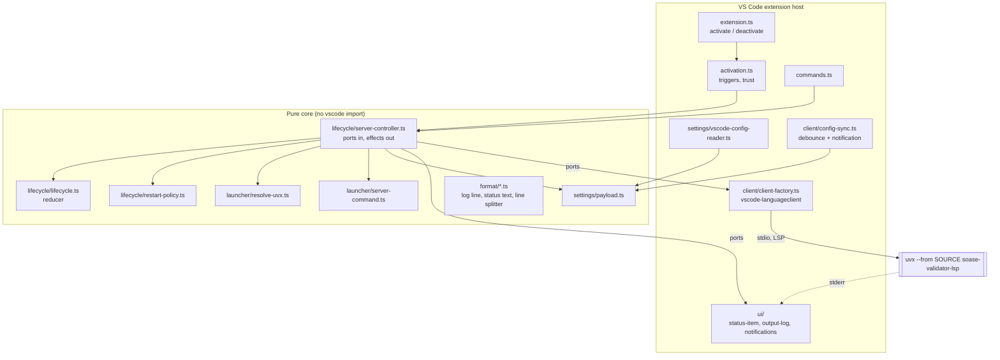
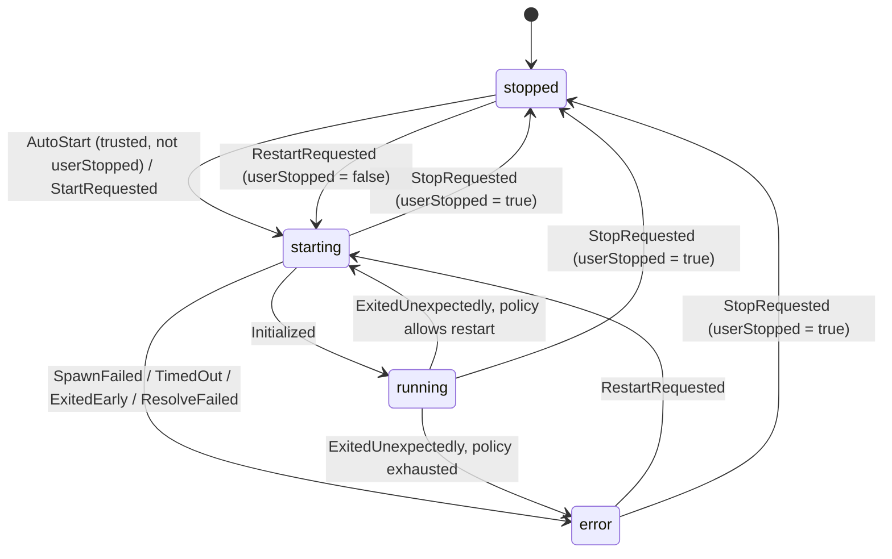

# Design Document

## Overview

The VS Code extension is a thin TypeScript wrapper around the existing `soase-validator-lsp` server. It contributes the `soase` language, finds `uvx`, starts the server over stdio through `vscode-languageclient`, forwards editor settings, and offers restart, stop, output and status commands. It contains no validation, completion, hover or reference logic (Requirement 9.9). Precedence among settings stays in the Engine.

The design splits the extension into two layers so that nearly all logic is testable without VS Code:

- Pure core modules with injected ports (file system, environment, platform, clock, process spawner, UI). They hold the `uvx` resolver, the server command builder, the settings payload builder, the lifecycle reducer, the restart policy, the debouncer and the formatters. Unit tests and property tests cover them in plain Node.
- A thin VS Code adapter layer (`extension.ts`, the client factory, status item, output channel, commands, configuration reader). It translates between the core ports and the `vscode` and `vscode-languageclient` APIs. Host tests with a stub LSP server cover it.

### Facts verified against the Server

These facts come from `src/soase_validator/lsp/server.py`, the engine configuration code and the installed `pygls`, and they fix parts of this design.

| Fact | Evidence | Consequence for the Extension |
| --- | --- | --- |
| `SETTINGS_SECTION = "soase-validator"`; `editor_settings_from` uses only that section when it is a mapping (an empty mapping counts), otherwise the whole payload | `server.py` | Both initialization options and `didChangeConfiguration.settings` are `{ "soase-validator": { ... } }` |
| Engine settings are read by walking nested objects (`_lookup` follows the key path through mappings); a flat key such as `"numeric.integerStrict"` is not found | `engine/config.py` | The payload builder must nest dotted keys: `{ numeric: { integerStrict: true } }` |
| `initialize` handler calls `set_editor_settings(editor_settings_from(params.initialization_options))`; `workspace/didChangeConfiguration` does the same with `params.settings`, reloads and revalidates open documents | `server.py` | Initialization options are re-evaluated on each start; the notification carries the full payload |
| The server is built as `LanguageServer(SERVER_NAME, SERVER_VERSION, ...)` with `"soase-validator"` and `"0.1.0"`; pygls documents these arguments as the source of the `serverInfo` sent to the client | `server.py`, `pygls/lsp/server.py` docstring | `serverInfo.version` is read from the `initialize` result (Requirements 7.6, 12.3). The runtime value has not been executed here; the stub test covers presence and absence, the integration test covers the real value |
| `main()` takes no arguments, calls `logging.basicConfig(stream=sys.stderr)` and `start_io()` | `server.py` | Do not pass `--stdio` or `--clientProcessId`; stderr carries logs, stdout carries only the protocol |
| Text sync is `Full`; the server registers `didSave`, `didOpen`, `didClose`, completion (triggers space and `"`), hover, definition and a quick-fix code action; there is no diagnostic provider (push model through `publishDiagnostics`) | `server.py`, `pygls/capabilities.py` | `vscode-languageclient` registers features from the advertised capabilities (Requirement 9.1); no middleware is needed for diagnostics |
| File watchers are registered dynamically (`client/registerCapability`, id `soase-validator-file-watchers`) and only when the client advertises `workspace.didChangeWatchedFiles.dynamicRegistration`; `relativePatternSupport` selects between relative patterns and absolute globs. The server also unregisters before re-registering | `server.py` `refresh_watchers` | The extension adds no static watchers; the language client handles dynamic registration (Requirements 9.5, 9.6) |
| `uvx --version` runs and prints the version | Run locally: `uvx 0.13.7 ...` | The version probe uses `uvx --version` (Requirement 3.6) |

### Verified behaviour of `vscode-languageclient` 11.0.0

Read from the published package source (`lib/node/main.js`, `lib/common/configuration.js`, `lib/common/client.js`):

- When `serverOptions` is a function, the client accepts a `ChildProcess` result, connects its stdin and stdout, and pipes only its stderr to the client's output channel. It does not remember the process, so on stop it will not terminate it. The Extension owns the process lifetime (spawn, graceful stop, forced kill).
- `DidChangeConfiguration` is sent by the client only when `clientOptions.synchronize.configurationSection` is set. Leaving it unset means the client never sends its own configuration notification, so the Extension sends its own with the exact payload.
- `initializationOptions` may be a function, evaluated at each `initialize`. Restarts therefore re-send current settings.
- `errorHandler` replaces the default restart logic. The Extension supplies one that always answers "do not restart" and runs its own restart policy (Requirement 11.3).

### Design decisions

1. **One unit/host runner: mocha.** `@vscode/test-electron` runs mocha inside the extension host, so mocha serves both the plain-Node unit tests (compiled output, no `vscode` import) and the host tests. `fast-check` supplies the property tests. This avoids a second runner such as vitest.
2. **No bundler.** `tsc` output in `out/` plus production `node_modules` are packaged by `vsce`. This keeps the toolchain small and keeps each dependency's license file in the `.vsix` (Requirement 13.2). `vscode-languageclient` is loaded with a dynamic `import()` on first start, so activation does not pay its load cost (Requirement 2.8).
3. **Process ownership.** The Extension spawns `uvx` itself (`shell: false`, argument array) and passes a `ChildProcess` to the client. This gives exact control of kill, stderr capture, exit code and the 20-line stderr tail (Requirements 5.4, 5.9, 7.3).
4. **Own restart policy.** The client's error handler never restarts; the Extension's `RestartPolicy` decides (Requirements 11.3, 11.4).
5. **Own configuration notification.** No `configurationSection`; the Extension sends `workspace/didChangeConfiguration` through `client.sendNotification` (Requirement 6.4).
6. **Settings scope.** All Server Settings and Extension settings use `scope: "window"`, so one value set per window feeds the one Server of the window (Requirement 5.14). The reader still inspects the workspace-folder value so a folder value is not silently lost if VS Code ever supplies one.
7. **Most-specific scope, unmerged.** For a set key the payload value is the value at the most specific scope that sets it (workspace folder, then workspace, then user). Object and array values are not merged across scopes. This keeps "values unchanged" (Requirement 6.8) and "no precedence logic" (Requirement 6.6).
8. **Free-form settings schema.** The contributed schema declares types only, with no `enum` for `gameVersion` or `manifest.unreferencedSeverity`, because the Extension must not judge meaning (Requirement 6.6). Descriptions name the accepted values and link to the project README.
9. **Test-only API.** `activate` returns an `ExtensionApi` with a spawn override only when `context.extensionMode === vscode.ExtensionMode.Test`, so host tests can start the stub server without a fake `uvx` binary. The override does not exist in production modes.
10. **Manual restart clears the crash window (decided).** A user-initiated start (the `soase-validator.restartServer` command and the "Restart server" notification action) clears the crash-loop counter, because the user has taken action. Requirement 11 is silent on this; the user confirmed the behaviour.
11. **No classification of `uvx` errors (decided).** The Extension does not recognise causes such as a missing Python interpreter or an unreachable network. Any exit before `initialize` takes the generic path: the first 20 stderr lines in the notification, the full output in the channel, no automatic retry (Requirements 10.6, 12.2). A classifier can be added later as a pure function over stderr text once sample `uvx` outputs are available; it would only change the notification text and not the lifecycle.
12. **Node 24 for build tooling and runtime (decided).** The build tooling (npm scripts, tests, `vsce`) runs on Node 24 and `@types/node` is the 24 line. The Extension itself runs in the Node embedded in VS Code's Electron; VS Code 1.141 embeds Node 24.21.0 (Electron 43.7.7), so the build and runtime Node majors match. A lint guard keeps `src/` to APIs available in the embedded runtime. See "Node versions" under Build and packaging.

## Architecture



The controller is the only component that decides when to spawn or kill. It receives events (activation trigger, trust change, command, process event, timer) and runs effects through ports. The reducer is a pure function; the controller is the thin interpreter around it.

### Lifecycle state machine



State is `stopped`, `starting`, `running` or `error`. Two further fields travel with it: `userStopped` (set by `stopServer`, cleared by `restartServer`) and `live` (a process exists). `live` is never true in `stopped`, and a `Spawn` effect is only emitted when `live` is false.

Rules the reducer implements:

- Auto-start triggers (activation, trust granted, SoaSE document opened) are honoured only in `stopped` with `userStopped = false` and a trusted workspace (Requirements 2.3, 2.4, 2.6, 2.7, 7.9). They are ignored in `error`, so a failed start is not retried silently (Requirement 2.9).
- `ExitedUnexpectedly` after `running` consults the restart policy; any exit before `running` goes to `error` without restart (Requirement 5.9).
- Every transition into `error` or `stopped` carries a `Kill` effect when `live` is true, so no process survives an error (Requirement 7.4).

## Components and Interfaces

All files are under `vscode-extension/`. File names are kebab-case; two-space indent, single quotes, semicolons and trailing commas apply; every exported symbol carries JSDoc.

### Module layout

```
vscode-extension/
  package.json, package-lock.json, tsconfig.json, eslint.config.mjs
  .vscodeignore, .mocharc.json, README.md, LICENSE
  scripts/
    package.mjs              # compile, lint, vsce package, atomic move
    check-vsix-contents.mjs  # asserts the file list from `vsce ls`
  src/
    extension.ts             # activate, deactivate, ExtensionApi
    activation.ts            # trigger decisions, trust wiring
    commands.ts              # command registration
    launcher/
      resolve-uvx.ts         # pure resolver
      server-command.ts      # source -> command and arguments, cwd choice
      uv-version.ts          # version probe through an injected exec port
      expand-path.ts         # ~ and environment variable expansion
    settings/
      server-settings-schema.ts   # the single list of Server Settings keys and types
      payload.ts                  # pure builder
      extension-settings.ts       # uvPath, serverSource, timeout, trace normalisation
      vscode-config-reader.ts     # adapter over workspace.getConfiguration().inspect()
    lifecycle/
      lifecycle.ts           # state, events, effects, reducer
      restart-policy.ts      # rolling-window policy
      server-controller.ts   # interpreter with ports
    client/
      client-factory.ts      # vscode-languageclient wiring
      spawn-server.ts        # child_process spawn, graceful and forced stop
      config-sync.ts         # debouncer and notification sender
      trace.ts               # setting value -> Trace
    format/
      log-line.ts            # timestamp and level
      status-text.ts         # showStatus text and status item labels
      line-splitter.ts       # chunk -> lines, tail buffer
    ui/
      status-item.ts, output-log.ts, notifications.ts
  test/
    unit/                    # plain Node, no vscode import
    properties/              # fast-check, one file per property
    host/                    # extension host tests
    stub/stub-lsp-server.ts  # stub LSP server process
    fixtures/                # synthetic mod files
```

### Launcher

`resolve-uvx.ts` is a pure function. Every effect is injected.

```ts
/** Platform values the resolver distinguishes. */
export type Platform = 'win32' | 'darwin' | 'linux';

/** Side-effect ports for the resolver. */
export interface ResolverPorts {
  readonly platform: Platform;
  readonly env: Readonly<Record<string, string | undefined>>;
  readonly homeDir: string;
  /** True when the path names an existing executable regular file. */
  isExecutableFile(path: string): boolean;
  joinPath(...parts: string[]): string;
}

/** Outcome of resolving uvx. */
export type UvxResolution =
  | { readonly found: true; readonly path: string; readonly source: 'uvPath' | 'path' | 'installer' | 'cargo' }
  | { readonly found: false; readonly searched: readonly string[]; readonly reason: 'uvPath-invalid' | 'not-found' };

/**
 * Resolves the uvx executable.
 *
 * @param uvPath Value of soase-validator.uvPath, possibly blank.
 * @param ports Injected environment.
 */
export function resolveUvx(uvPath: string, ports: ResolverPorts): UvxResolution;
```

Algorithm:

1. Executable name: `uvx.exe` on `win32`, otherwise `uvx` (Requirement 3.4).
2. If `uvPath.trim()` is non-empty: expand a leading `~` and environment references with `expandPath` (Requirement 3.5), then test only that path. Found gives `source: 'uvPath'`; otherwise return `found: false`, `reason: 'uvPath-invalid'`, `searched: [expanded]`, and do not look anywhere else (Requirements 3.1, 3.7).
3. Otherwise search, in order: each directory of `PATH` (split on `;` on Windows, `:` elsewhere; the variable name is `Path` or `PATH` according to case-insensitive match on Windows); then `<home>/.local/bin` (`%USERPROFILE%\.local\bin` on Windows); then `$CARGO_HOME/bin`, with `CARGO_HOME` defaulting to `<home>/.cargo` when unset or empty (Requirements 3.2, 3.3). The first existing candidate wins.
4. Every probed candidate path is appended to `searched`, in probe order, which the missing-`uv` path writes one per line to the output channel (Requirement 4.2).

A `.cmd` or `.bat` target is not an executable for this purpose. Node refuses to spawn those without a shell on current releases, and the Extension never uses a shell (Requirement 5.4). The README says `uvPath` must name `uvx` or `uvx.exe` itself.

`uv-version.ts` exposes `probeUvVersion(uvxPath, exec, timeoutMs = 10_000)`, where `exec` is an injected `(file, args, timeoutMs) => Promise<{ code: number; stdout: string }>` port. It runs `uvx --version` and returns `{ available: true, text }` or `{ available: false, reason }` for a spawn failure, a non-zero exit or a timeout. The controller logs the result and keeps `uvx` resolved either way (Requirements 3.6, 3.8). The probe runs in the background after resolution and never delays the start.

`server-command.ts`:

```ts
/** Default source of the Server package. */
export const DEFAULT_SERVER_SOURCE = 'git+https://github.com/Donos47/soase-validator';

/** Command line for the Server. */
export interface ServerCommand {
  readonly executable: string;
  readonly args: readonly string[];
  readonly cwd: string;
}

/**
 * Builds the Server Command.
 *
 * @param uvxPath Resolved uvx path.
 * @param serverSource Value of soase-validator.serverSource, possibly blank.
 * @param workspaceFolders File system paths of the open workspace folders.
 * @param homeDir The user's home directory.
 */
export function buildServerCommand(
  uvxPath: string,
  serverSource: string,
  workspaceFolders: readonly string[],
  homeDir: string,
): ServerCommand;
```

Arguments are exactly `['--from', source, 'soase-validator-lsp']`, where `source` is the trimmed `serverSource` when it has any non-whitespace character and `DEFAULT_SERVER_SOURCE` otherwise (Requirements 5.2, 5.3). `cwd` is the first workspace folder or the home directory (Requirement 5.12). The source string is passed unchanged (no expansion), because `uvx` interprets it and an argument array is used (Requirement 5.4). No tag or commit is pinned (Requirement 5.3).

`spawn-server.ts` is the only module that imports `child_process`:

```ts
/** A running Server process as the controller sees it. */
export interface ServerProcess {
  readonly pid: number | undefined;
  readonly child: ChildProcess;
  /** Resolves with the exit code and signal after the process ends. */
  readonly exited: Promise<{ code: number | null; signal: string | null }>;
  /** Sends SIGTERM, or kills the process tree on Windows. */
  kill(): void;
}

/** Spawns the Server Command with shell disabled and all three stdio streams piped. */
export function spawnServer(command: ServerCommand, env: NodeJS.ProcessEnv): ServerProcess;
```

Stopping first uses the LSP `shutdown` and `exit` through `client.stop()`. If the process has not exited 5 seconds after the stop request, `kill()` runs and the forced termination is logged (Requirement 7.3). `kill()` terminates the process tree: `taskkill /PID <pid> /T /F` on Windows, and on POSIX the child is spawned with `detached: true` and the group is signalled with `process.kill(-pid, 'SIGTERM')`. `uvx` runs the Server as a child process, so killing only the parent could leave the Python interpreter running. This tree-kill behaviour is not verified here; see Open Items.

### Settings payload builder

`server-settings-schema.ts` is the single source of truth for the Server Settings keys, shared by the builder, the manifest generator test and the README consistency test:

```ts
/** Value types a Server Setting can declare. */
export type SettingType =
  | 'string' | 'boolean' | 'string[]' | 'object<string,string>';

/** One Server Setting. */
export interface ServerSettingDef {
  /** soase.json key, dotted for nested keys, for example numeric.integerStrict. */
  readonly key: string;
  readonly type: SettingType;
}

/** The Server Settings keys of Requirement 6.2. */
export const SERVER_SETTINGS: readonly ServerSettingDef[] = [
  { key: 'gameVersion', type: 'string' },
  { key: 'referenceRoots', type: 'object<string,string>' },
  { key: 'modRoots', type: 'string[]' },
  { key: 'layers', type: 'string[]' },
  { key: 'aliases', type: 'object<string,string>' },
  { key: 'language', type: 'string' },
  { key: 'disabledCodes', type: 'string[]' },
  { key: 'numeric.integerStrict', type: 'boolean' },
  { key: 'numeric.decimalAllowInteger', type: 'boolean' },
  { key: 'manifest.unreferencedSeverity', type: 'string' },
  { key: 'manifest.exemptUnlisted', type: 'string[]' },
  { key: 'manifest.exemptUnreferenced', type: 'string[]' },
  { key: 'reportOverrides', type: 'boolean' },
  { key: 'suppressLimitedReferenceNotice', type: 'boolean' },
];
```

The types match the README settings table and the Engine's `_lookup` consumers (`referenceRoots` and `aliases` are objects from name to path text; `modRoots`, `layers`, `disabledCodes` and the two `exempt*` keys are lists of strings).

`payload.ts`:

```ts
/** Values of one setting at each VS Code scope; undefined means not set there. */
export interface ScopedValue {
  readonly globalValue?: unknown;
  readonly workspaceValue?: unknown;
  readonly workspaceFolderValue?: unknown;
}

/** Reads the scoped values of one setting key. */
export type ConfigReader = (key: string) => ScopedValue;

/** Result of building the payload. */
export interface PayloadResult {
  /** Always exactly one top-level member, 'soase-validator'. */
  readonly payload: { readonly 'soase-validator': Readonly<Record<string, unknown>> };
  /** One entry per key whose set value has the wrong type. */
  readonly invalid: readonly { readonly key: string; readonly value: unknown }[];
}

/**
 * Builds the settings payload for initializationOptions and didChangeConfiguration.
 *
 * @param read Injected configuration reader.
 */
export function buildPayload(read: ConfigReader): PayloadResult;
```

For each key in `SERVER_SETTINGS`:

1. Take the value at the most specific scope that is not `undefined` (`workspaceFolderValue`, then `workspaceValue`, then `globalValue`). If none is set, omit the key (Requirement 6.5). An explicit empty list, empty object or empty string counts as set and is sent as is.
2. If the value does not match the declared `type` (a shallow check: a string is a `string`; a `string[]` is an array whose items are all strings; an `object<string,string>` is a non-null non-array object whose values are all strings; a `boolean` is a boolean), omit the key and record it in `invalid` (Requirement 11.5). The check never looks at meaning: `gameVersion: 'nonsense'` is a string and is sent.
3. Otherwise write the value, unchanged, into the output at the nested location of the key: `numeric.integerStrict` becomes `{ numeric: { integerStrict: value } }`, because the Engine walks nested objects. Strings are copied character for character, including `~`, `%VAR%`, `$VAR` and backslashes (Requirement 6.8).

The caller de-duplicates warnings: `output-log.ts` keeps a set of `key + JSON.stringify(value)` pairs and writes one `warn` line per new pair.

`vscode-config-reader.ts` implements `ConfigReader` with `workspace.getConfiguration('soase-validator').inspect(key)` and passes only the three explicit scope members. It ignores `defaultValue`, which is how an unset key stays unset.

`extension-settings.ts` has pure normalisers:

- `normaliseTimeout(raw: unknown): { seconds: number; warning?: string }`: a finite number of at least 10 gives itself; a number below 10 gives 10 with a warning; anything else, including `NaN`, gives 180 with a warning (Requirements 5.8, 11.8).
- `normaliseTrace(raw: unknown): 'off' | 'messages' | 'verbose'`, defaulting to `off`.
- `readString(raw: unknown): string`, returning `''` for non-strings.

### Lifecycle

`lifecycle.ts` defines the pure model:

```ts
/** Server states shown to the user. */
export type ServerState = 'stopped' | 'starting' | 'running' | 'error';

/** Reducer state. */
export interface Lifecycle {
  readonly state: ServerState;
  readonly live: boolean;
  readonly userStopped: boolean;
  readonly trusted: boolean;
  readonly generation: number;
  readonly exits: readonly number[];
}

/** Events fed to the reducer. */
export type LifecycleEvent =
  | { readonly type: 'AutoStart' }
  | { readonly type: 'TrustChanged'; readonly trusted: boolean }
  | { readonly type: 'RestartRequested' }
  | { readonly type: 'StopRequested' }
  | { readonly type: 'Resolved' }
  | { readonly type: 'ResolveFailed' }
  | { readonly type: 'SpawnFailed' }
  | { readonly type: 'Initialized' }
  | { readonly type: 'TimedOut' }
  | { readonly type: 'Exited'; readonly at: number; readonly requested: boolean }
  | { readonly type: 'RestartTimerFired' };

/** Effects the controller executes. */
export type LifecycleEffect =
  | { readonly type: 'Resolve' }
  | { readonly type: 'Spawn' }
  | { readonly type: 'Kill' }
  | { readonly type: 'Notify'; readonly kind: 'resolve-failed' | 'spawn-failed' | 'timeout' | 'exited' | 'restarts-stopped' }
  | { readonly type: 'Log'; readonly level: 'info' | 'warn' | 'error'; readonly message: string };

/** Reducer: pure, total over all state and event combinations. */
export function step(
  current: Lifecycle,
  event: LifecycleEvent,
  policy: RestartPolicy,
): { readonly next: Lifecycle; readonly effects: readonly LifecycleEffect[] };
```

`generation` increments on each start and tags the process, timers and client of that start. A late `Exited` or `Initialized` from an old generation is dropped by the controller before reaching the reducer, which prevents a killed process from re-triggering a restart (Requirement 5.13). An `Exited` with `requested: true` (the user stopped or restarted it) never counts toward the crash window.

`restart-policy.ts`:

```ts
/** Rolling window policy: at most maxRestarts restarts within windowMs. */
export interface RestartPolicy {
  readonly maxRestarts: number;
  readonly windowMs: number;
}

/** Defaults from Requirement 11: three restarts in five minutes. */
export const DEFAULT_RESTART_POLICY: RestartPolicy = { maxRestarts: 3, windowMs: 300_000 };

/**
 * Decides whether an unexpected exit is followed by an automatic restart.
 *
 * @param previousExits Timestamps (ms) of earlier unexpected exits, ascending.
 * @param now Timestamp (ms) of the exit being decided.
 * @param policy The policy.
 * @returns restart is true when fewer than maxRestarts earlier exits lie within windowMs of now.
 */
export function decideRestart(
  previousExits: readonly number[],
  now: number,
  policy: RestartPolicy,
): { readonly restart: boolean; readonly exits: readonly number[] };
```

An earlier exit lies within the window when `now - t < windowMs`. The first, second and third unexpected exits in a window restart; the fourth does not (Requirements 11.3, 11.4). `exits` is the pruned list with `now` appended, so the reducer state stays bounded.

`server-controller.ts` is the interpreter. Its ports:

```ts
/** Everything the controller needs from the outside. */
export interface ControllerPorts {
  readonly now: () => number;
  readonly setTimer: (ms: number, fn: () => void) => { cancel(): void };
  readonly resolve: () => UvxResolution;
  readonly probeVersion: (uvxPath: string) => Promise<UvVersionResult>;
  readonly settings: () => { serverSource: string; timeoutSeconds: number; trace: TraceSetting };
  readonly folders: () => { paths: readonly string[]; home: string };
  readonly startClient: (cmd: ServerCommand, hooks: ClientHooks) => Promise<StartedClient>;
  readonly ui: UiPort;
}
```

`UiPort` covers `setState(state)`, `log(level, message)`, `notifyError(kind, details, actions)` and `openInstallDocs()`, `openUvPathSetting()`, `showOutput()`. `startClient` wraps spawn plus client start; in production it uses `client-factory.ts` and `spawn-server.ts`, in unit tests it is a fake, and in host tests the production factory runs with a spawn override pointing at the stub server.

Sequence for a start (`Spawn` effect):

1. `resolve()`; on `found: false` log each `searched` entry, set `error`, show one notification with the actions "Open install instructions" and "Set uvPath", and do not spawn (Requirements 4.1 to 4.3). Dismissing leaves the state `error` and shows nothing more until the next activation attempt or restart (Requirement 4.6). The actions call `openInstallDocs()` (the `uv` installation documentation URL, opened with `env.openExternal`) and `executeCommand('workbench.action.openSettings', 'soase-validator.uvPath')` (Requirements 4.4, 4.5).
2. Log the resolved path; start `probeVersion` in the background and log its result (Requirements 3.6, 3.8).
3. Build the command, set the timer for `timeoutSeconds`, call `startClient`. `starting` lasts until `client.start()` resolves, which happens after the `initialize` response (Requirement 5.7).
4. On timeout, `Kill`, log "startup timed out after N seconds" once, set `error`, notify with "Show output" and "Restart server" (Requirements 5.8, 11.1).
5. On `Exited` the controller supplies the exit code and the stderr tail (the last 20 lines from the line splitter) to the log (Requirement 5.9).

When `uvx` exits before `initialize` completes, the notification shows the first 20 lines of captured stderr, and the full output is already in the output channel (Requirement 12.2). The Extension does not classify the cause (for example "no Python available" or "network unavailable"); see Design decision 11. Requirement 10.6 is met by the same generic path: exit before `initialize`, no automatic retry, documents untouched.

### Language client wiring

`client-factory.ts` (the only module importing `vscode-languageclient/node`, loaded with `await import(...)`):

```ts
const options: LanguageClientOptions = {
  documentSelector: [{ scheme: 'file', language: 'soase' }],
  outputChannel,            // stderr from the Server and trace output
  traceOutputChannel: outputChannel,
  initializationOptions: () => buildPayload(reader).payload,
  errorHandler: {
    error: () => ({ action: ErrorAction.Continue }),
    closed: () => ({ action: CloseAction.DoNotRestart, handled: true }),
  },
  // No synchronize.configurationSection: the Extension sends its own notification.
  // No middleware: results and diagnostics pass through unchanged.
};
const serverOptions: ServerOptions = async () => serverProcess.child;
```

Decisions behind each option:

- `documentSelector` with `scheme: 'file'` and `language: 'soase'` restricts document sync to SoaSE Files. A `.manifest` file or any other file never reaches the Server (Requirements 1.3, 1.4, 1.6).
- Diagnostics, completion, hover, definition, code actions and file watchers are registered by the client from the server's capabilities and dynamic registrations, with no middleware. The Extension therefore adds, drops, merges or reorders nothing (Requirements 9.1 to 9.8). Request failures use the client's default failed-request handling, which returns an empty result; a host test confirms that the stub's error response produces no substitute result and leaves Diagnostics untouched.
- `outputChannel` receives the Server's stderr lines through the client (verified above). The controller additionally attaches its own `stderr` listener to feed the 20-line tail buffer; the client's pipe and the tail buffer both read the same stream without interfering.
- The client's stdout handling uses the protocol reader only. The Extension never writes to `child.stdin` (Requirement 5.6).

Trace: `trace.ts` maps the setting to the library's `Trace` enum (`off` to `Trace.Off`, `messages` to `Trace.Messages`, `verbose` to `Trace.Verbose`). The value is applied on start with `client.setTrace` and again on `onDidChangeConfiguration` for `soase-validator.trace.server`, without a restart (Requirements 8.9 to 8.13). Per the library, `Messages` logs method names and ids and `Verbose` adds parameters, which matches Requirements 8.11, 8.12 and 8.14. The host test checks that with `off` and `messages` no document text reaches the output channel.

`config-sync.ts`:

```ts
/** Debounces change events and sends one didChangeConfiguration with the full payload. */
export class ConfigSync {
  constructor(deps: {
    readonly now: () => number;
    readonly setTimer: (ms: number, fn: () => void) => { cancel(): void };
    readonly send: () => void;
    readonly quietMs: number;   // 250
    readonly maxWaitMs: number; // 500
  });
  /** Records a Server Setting change. */
  notifyChange(): void;
  dispose(): void;
}
```

A change event starts a 250 ms quiet timer that restarts on each further change, but the notification is sent no later than 500 ms after the first change in the burst. This keeps every change within 1000 ms of its notification (Requirement 6.4). `send` rebuilds the payload at send time and calls `client.sendNotification('workspace/didChangeConfiguration', { settings: payload })`, with the same `{ 'soase-validator': { ... } }` shape as the initialization options. Only changes that affect a Server Setting key (`event.affectsConfiguration('soase-validator.<key>')` for a key in `SERVER_SETTINGS`) call `notifyChange`; changes to `uvPath`, `serverSource`, `startupTimeoutSeconds` and `trace.server` do not. Changes to `soase.json` or the user-level file send nothing, because the Extension watches neither (Requirement 6.9). When the Server is not running, nothing is sent; the next `initialize` carries the current payload.

### Activation and trust

`activation.ts` holds the trigger logic. `package.json` declares the activation events; at runtime:

- `activate` registers commands, status item, output channel, listeners and the controller, then calls `controller.dispatch({ type: 'AutoStart' })` without awaiting it (Requirement 2.8). All work after that is asynchronous.
- `workspace.isTrusted` seeds `Lifecycle.trusted`. `workspace.onDidGrantWorkspaceTrust` dispatches `TrustChanged` and then `AutoStart`, which starts the Server once without a reload (Requirement 2.7).
- `workspace.onDidOpenTextDocument` dispatches `AutoStart` for documents with `languageId === 'soase'` and scheme `file`. The reducer ignores it unless the state is `stopped` and `userStopped` is false (Requirements 2.4, 7.9, 7.10).
- Activation itself is the only trigger that exists when the workspace holds neither a SoaSE File nor `soase.json`, because VS Code activates the Extension only through the declared events (Requirement 2.3).
- The whole of `activate` is wrapped in a try/catch that logs the message to the output channel, shows one error notification and returns normally (Requirement 11.6).

### Status item and output channel

- `output-log.ts` creates exactly one `OutputChannel` named `SoaSE Validator` and formats Extension lines as `<ISO-8601 timestamp> [<level>] <message>` with level in `error`, `warn`, `info`, `debug` (Requirements 8.1, 8.8). Raw Server stderr lines and library trace output are written by the client without this prefix; only Extension messages carry it.
- `status-item.ts` owns one `StatusBarItem`, left-aligned, with command `soase-validator.showStatus` (Requirement 8.7). Text per state: `$(circle-slash) SoaSE: stopped`, `$(sync~spin) SoaSE: starting`, `$(check) SoaSE: running`, `$(error) SoaSE: error`. Error uses `statusBarItem.errorBackground`. The item is updated synchronously in the `setState` port call (Requirement 8.3), shows `stopped` until the first start (Requirement 8.4), and is shown only while `window.activeTextEditor?.document.languageId === 'soase'` (Requirements 8.5, 8.6) through `window.onDidChangeActiveTextEditor`.
- Logging goes only to the channel or `console.error`. ESLint forbids `console.log`, `console.info` and any `process.stdout` use in `src/` (Requirement 15.11). `console.error` is also forbidden in `src/` except through `output-log.ts`, which uses it only if the channel is disposed.

### Commands

`commands.ts` registers four commands, all available in the command palette (no `commandPalette` entry hides them):

| Command id | Title | Behaviour |
| --- | --- | --- |
| `soase-validator.restartServer` | SoaSE Validator: Restart Server | Dispatches `RestartRequested`: stop the process (forced kill after 5 s), re-resolve `uvx`, rebuild the command, start a new process; `initializationOptions` is evaluated again so settings are re-sent. Clears `userStopped` and the crash history (Requirements 7.2, 7.3, 7.10) |
| `soase-validator.stopServer` | SoaSE Validator: Stop Server | Dispatches `StopRequested`; sets `userStopped` (Requirements 7.8, 7.9) |
| `soase-validator.showOutput` | SoaSE Validator: Show Output | `outputChannel.show(true)` |
| `soase-validator.showStatus` | SoaSE Validator: Show Status | `window.showInformationMessage(formatStatus(snapshot), { modal: false })` |

`status-text.ts` exports `formatStatus(snapshot: StatusSnapshot): string`, where the snapshot holds `state`, `uvxPath?`, `command?` and `serverVersion?`. Each missing value renders as `not available`. The Server version is the exception: when the Server is running and the `initialize` result has no `serverInfo.version`, it renders `unknown` (Requirement 12.4); when the Server is not running it renders `not available` (Requirement 7.7).

## Data Models

### `package.json` contributions

```jsonc
{
  "name": "soase-validator",
  "displayName": "SoaSE Validator",
  "publisher": "<publisher placeholder>",
  "version": "0.1.0",
  "license": "MIT",
  "engines": { "vscode": "^1.141.0", "node": ">=24" },
  "main": "./out/extension.js",
  "activationEvents": [
    "onLanguage:soase",
    "workspaceContains:**/soase.json",
    "workspaceContains:**/*.{entity,galaxy,brushes,sounddata,str,constants,galaxyScenarioDef,particle,explosiondata}"
  ],
  "capabilities": {
    "untrustedWorkspaces": {
      "supported": "limited",
      "description": "The Server is not started in an untrusted workspace, because the Server Command and settings name executables and file paths."
    }
  },
  "contributes": {
    "languages": [{
      "id": "soase",
      "aliases": ["SoaSE", "Sins of a Solar Empire"],
      "extensions": [".entity", ".galaxy", ".brushes", ".sounddata", ".str", ".constants",
                     ".galaxyScenarioDef", ".particle", ".explosiondata"]
    }],
    "configuration": { "title": "SoaSE Validator", "properties": { "...": "see below" } },
    "commands": [
      { "command": "soase-validator.restartServer", "title": "SoaSE Validator: Restart Server" },
      { "command": "soase-validator.stopServer",    "title": "SoaSE Validator: Stop Server" },
      { "command": "soase-validator.showOutput",    "title": "SoaSE Validator: Show Output" },
      { "command": "soase-validator.showStatus",    "title": "SoaSE Validator: Show Status" }
    ]
  }
}
```

The `publisher` value is not known; see Open Items. `activationEvents` also lists the four commands implicitly (VS Code generates `onCommand` events for contributed commands). The brace glob in `workspaceContains` is supported by VS Code's glob matcher.

Configuration properties. Every Server Setting has `scope: "window"`, a type taken from `SERVER_SETTINGS`, and a description that ends with: "A project `soase.json` and the Server's environment variables take precedence over this value. See the configuration section of the soase-validator README." (Requirement 6.7). Examples use placeholders only (Requirement 6.10).

| Setting id | JSON type | Default | Notes |
| --- | --- | --- | --- |
| `soase-validator.gameVersion` | string | none | no `enum` |
| `soase-validator.referenceRoots` | object, `additionalProperties: string` | none | example `{ "rebellion-1.98": "~/path/to/sins-rebellion-reference" }` |
| `soase-validator.modRoots` | array of string | none | |
| `soase-validator.layers` | array of string | none | |
| `soase-validator.aliases` | object of string | none | |
| `soase-validator.language` | string | none | |
| `soase-validator.disabledCodes` | array of string | none | |
| `soase-validator.numeric.integerStrict` | boolean | none | |
| `soase-validator.numeric.decimalAllowInteger` | boolean | none | |
| `soase-validator.manifest.unreferencedSeverity` | string | none | |
| `soase-validator.manifest.exemptUnlisted` | array of string | none | |
| `soase-validator.manifest.exemptUnreferenced` | array of string | none | |
| `soase-validator.reportOverrides` | boolean | none | |
| `soase-validator.suppressLimitedReferenceNotice` | boolean | none | |
| `soase-validator.uvPath` | string | `""` | Extension setting; `restrictedConfigurations` |
| `soase-validator.serverSource` | string | `""` | Extension setting; `restrictedConfigurations` |
| `soase-validator.startupTimeoutSeconds` | number | `180` | `minimum: 10` |
| `soase-validator.trace.server` | string enum `off`, `messages`, `verbose` | `off` | |

A Server Setting declares no `default` key, so `inspect().defaultValue` is `undefined` and VS Code's settings UI shows it unset. The Engine's own defaults apply, and the README describes them rather than the manifest (Requirement 14.4). `capabilities.untrustedWorkspaces.restrictedConfigurations` lists `soase-validator.uvPath` and `soase-validator.serverSource`.

### Payload shape

```json
{
  "soase-validator": {
    "gameVersion": "rebellion-1.98",
    "referenceRoots": { "rebellion-1.98": "~/path/to/sins-rebellion-reference" },
    "numeric": { "integerStrict": true },
    "disabledCodes": []
  }
}
```

Used verbatim for `initializationOptions` and for `settings` in `workspace/didChangeConfiguration`. With nothing set, the payload is `{ "soase-validator": {} }`, which `editor_settings_from` reads as an empty mapping.

### Status snapshot

```ts
/** What showStatus displays. */
export interface StatusSnapshot {
  readonly state: ServerState;
  readonly uvxPath?: string;
  readonly command?: string;     // executable and arguments joined by spaces for display only
  readonly serverVersion?: string | 'unknown';
}
```

### Build and packaging

`package.json` scripts (versions in the table below):

| Script | Command | Purpose |
| --- | --- | --- |
| `compile` | `tsc -p ./` | emit `out/` |
| `lint` | `eslint .` | lint `src`, `test`, `scripts` |
| `test:unit` | `mocha` (config in `.mocharc.json`, spec `out/test/unit/**/*.js` and `out/test/properties/**/*.js`) | unit and property tests |
| `test:host` | `node ./out/test/host/run-tests.js` | extension host tests through `@vscode/test-electron` |
| `test` | `npm run compile && npm run test:unit && npm run test:host` | one command for the full suite (Requirement 15.1) |
| `audit` | `npm audit --audit-level=high` | surfaces high and critical findings (Requirement 13.10) |
| `package` | `node scripts/package.mjs` | build the `.vsix` |

`scripts/package.mjs` runs these steps in order with `child_process.spawnSync(process.execPath, [binScript, ...args])`, no shell: (1) remove `out/`; (2) `tsc` (step name `compile`); (3) `eslint` (step name `lint`); (4) `vsce ls` and `check-vsix-contents.mjs` (step name `contents`); (5) `vsce package --out dist/.build/soase-validator-<version>.vsix`; (6) move the file to `dist/`. Any non-zero exit prints `package failed at step: <name>`, removes `dist/.build/` and any `.vsix` it wrote, and exits with a non-zero code, so no partial file stays in the output location (Requirements 13.5, 15.10). A clean checkout needs only `npm ci` and `npm run package` (Requirement 13.4).

`check-vsix-contents.mjs` asserts from the `vsce ls` list: `package.json`, `README.md`, `LICENSE`, `out/extension.js` and the license file of each production dependency are present, and nothing under `src/soase_validator`, `reference/`, `tests/` or `.kiro/`, no `uv` binary and no `*.json` Definition is present (Requirements 13.2, 13.3).

`.vscodeignore` excludes `src/**`, `test/**`, `scripts/**`, `out/test/**`, `**/*.map`, `.vscode-test/**`, `eslint.config.mjs`, `tsconfig.json` and `dist/**`, and does not exclude `node_modules/**/LICENSE*`.

### Dependency versions

Checked on the npm registry when this design was written:

| Package | Latest | Chosen range | Role and note |
| --- | --- | --- | --- |
| `vscode-languageclient` | 11.0.0 | `^11.0.0` | runtime; `engines.vscode ^1.91.0` |
| `vscode-languageserver` | 11.0.0 | `^11.0.0` | dev; stub LSP server |
| `@types/vscode` | 1.145.0 | `~1.140.0` | dev; see note 1 |
| `@types/node` | 24.19.2 (24.x line; registry `latest` is 26.x) | `^24.19.2` | dev; see note 2 and the Node versions section |
| `eslint-plugin-n` | 18.5.0 | `^18.5.0` | dev; runtime API guard, see the Node versions section; peer `eslint >=8.57.1` |
| `typescript` | 7.0.2 | `~6.0.3` | dev; see note 3 |
| `eslint` | 10.14.0 | `^10.14.0` | dev; needs Node `^20.19 \|\| ^22.13 \|\| >=24` |
| `typescript-eslint` | 8.72.1 | `^8.72.1` | dev; peer `typescript >=4.8.4 <6.1.0` |
| `@vscode/vsce` | 4.1.0 | `^4.1.0` | dev; needs Node >= 22 |
| `@vscode/test-electron` | 3.1.0 | `^3.1.0` | dev; host test runner, needs Node >= 22 |
| `@vscode/test-cli` | 0.0.15 | not used | pre-1.0; `@vscode/test-electron` is enough |
| `mocha` | 12.0.3 | `^12.0.3` | dev; needs Node `^20.19 \|\| >=22.12` |
| `@types/mocha` | 10.0.10 | `^10.0.10` | dev |
| `fast-check` | 4.10.2 | `^4.10.2` | dev; property tests |
| `vitest` | 5.1.0 | not used | mocha is the single runner |
| `esbuild` | 0.28.2 | not used | no bundler |

1. `vsce` rejects a package whose `@types/vscode` is newer than `engines.vscode`. `engines.vscode` is `^1.141.0` (Requirement 13.7), and the npm registry has no `@types/vscode@1.141.0`; the highest version at or below 1.141 is 1.140.0, so the dev range is `~1.140.0`. The registry's 1.145.0 would break `vsce package`.
2. `@types/node` follows the Node 24 line by user decision, which matches the Node embedded in VS Code 1.141. The registry `latest` tag points at a newer major, so the range is pinned to `^24.19.2` to stay on the 24 line.
3. `typescript` 7.0.2 is the registry's latest, but `typescript-eslint` 8.72.1 declares `typescript <6.1.0`. The design uses the latest 6.0.x line. This departs from the "latest" preference, and the reason is the peer range. `npm install` with an unmet peer range fails under npm 7 and later, so the choice is forced, not a preference.

#### Node versions

Facts checked on npm and nodejs.org when this design was written, plus the published VS Code to Electron to Node mapping:

| Item | Value | Status |
| --- | --- | --- |
| Node.js 24 | 24.22.2, codename Krypton | LTS since 2025-10-28; maintenance LTS since 2026-10-20; end of life 2028-04-30 |
| `@types/node` 24 | 24.19.2, the highest 24.x on the registry | stable |
| Node embedded in VS Code 1.141.0 to 1.143.1 | 24.21.0 (Electron 43.7.7) | same major as the build Node; version from a community mapping |
| Build tooling engines | `@vscode/vsce` and `@vscode/test-electron` `>=22`; `mocha` `^20.19 \|\| >=22.12`; `eslint` and `eslint-plugin-n` `^20.19 \|\| ^22.13 \|\| >=24`; `typescript` 6.0.x `>=14.17`; `typescript-eslint` `^18.18 \|\| ^20.9 \|\| >=21.1` | all accept Node 24 |

Node 24 is in maintenance LTS, so it receives security fixes only until 2028-04-30; this is the same major that the minimum supported VS Code embeds.

Two Node installations are involved, and they share a major version:

- **Build and test Node** (the developer's or CI's Node). It runs `npm` scripts, `tsc`, `eslint`, `mocha`, `vsce` and the `@vscode/test-electron` launcher. The design sets `engines.node` to `>=24` in `package.json` and the build documentation (`vscode-extension/README.md`, section "Building from source") states "Node.js 24 or newer and npm" as the prerequisite. A `.node-version` file in `vscode-extension/` contains `24`.
- **Runtime Node** (the Node inside VS Code's Electron extension host). It runs the compiled extension. For the minimum supported VS Code, 1.141, it is Node 24.21.0. A newer developer Node can still expose built-in APIs that the embedded runtime lacks, so the source is guarded as follows.

1. **Lint guard.** `eslint-plugin-n` rule `n/no-unsupported-features/node-builtins` is enabled for `src/` with `version: '>=24.21.0'`, so any Node built-in API newer than the embedded runtime is an error. A companion `n/no-unsupported-features/es-builtins` and `es-syntax` pair uses the same version. The `version` value lives in one constant that the packaging check keeps in step with `MIN_EMBEDDED_NODE` below.
2. **Allowed Node surface.** `src/` imports only `node:child_process` (spawn adapter), `node:fs`, `node:path`, `node:os` and `node:process`, and uses `Buffer`, `TextDecoder` and timers. `no-restricted-imports` rejects every other `node:` module in `src/`.
3. **Host test on the minimum VS Code.** The host suite runs on VS Code `1.141.0` (the `engines.vscode` floor, passed to `@vscode/test-electron` as `version`) and on `stable`. The minimum-version run is the one that proves the compiled output works on the embedded Node 24.21.0. The test also asserts `process.versions.node` inside the host against the expected value for the pinned VS Code and logs it, so a change of the embedded runtime is visible.
4. **Single place to change.** `MIN_EMBEDDED_NODE = '24.21.0'` is a constant in `scripts/` used by the lint config and the host test. When `engines.vscode` is raised, update it from the VS Code to Node mapping.
Run `npm audit` after install and after every dependency change, and report high and critical findings. `vscode-languageclient` is the only runtime dependency; its dependencies are `semver`, `minimatch`, `vscode-languageserver-protocol` and `vscode-languageserver-textdocument`.

`tsconfig.json`: `module` and `moduleResolution` `node16`, `target` `ES2022`, `strict`, `noUncheckedIndexedAccess`, `outDir` `out`, `rootDir` `.` (so `test/` compiles next to `src/`), `sourceMap` on, `lib` `["ES2022"]`.

`eslint.config.mjs` (flat config with `typescript-eslint`): recommended type-checked rules; `no-console` with no allowed methods in `src/`; `no-restricted-properties` for `process.stdout` and `process.stderr` writes in `src/`; `no-restricted-imports` for `http`, `https`, `net`, `dgram`, `tls`, `node:` variants of those, `child_process` outside `src/client/spawn-server.ts` and `src/launcher/uv-version.ts`'s injected exec adapter, and the `vscode` module inside `src/launcher`, `src/settings` (except `vscode-config-reader.ts`), `src/lifecycle` and `src/format`; `@typescript-eslint/no-require-imports`. The restricted network imports back Requirements 10.1 to 10.3 and the `vscode` restriction keeps the core pure.

### Repository integration

- `.gitignore` gains `node_modules/`, `vscode-extension/out/`, `vscode-extension/dist/`, `vscode-extension/.vscode-test/` and `*.vsix` (Requirement 16.2).
- `.kiro/steering/structure.md` gains the `vscode-extension/` tree and its tooling and output directories (Requirement 16.3).
- `.kiro/steering/tech.md` gains: "Node.js and npm are used only for the VS Code extension in `vscode-extension/`; the Engine, LSP server, MCP server and CLI remain Python" (Requirement 16.4).
- `README.md` replaces the "Use from VS Code" paragraph that says no extension is shipped, and its generic LSP client instructions, with a link to `vscode-extension/README.md` once the extension is released (Requirement 14.6); the "Future improvements" bullet about the extension is removed at the same time.
- Python tooling: `pyproject.toml` has `testpaths = ["tests"]` for pytest and `extend-exclude = [".kiro"]` for ruff. Ruff scans `*.py` files only and the extension contains none except the stub if it were Python (it is TypeScript), so `uv run ruff check`, `ruff format --check` and `pytest` are unaffected. Add `vscode-extension` to `[tool.ruff] extend-exclude` as defence in depth for a stray `node_modules` Python file (Requirement 16.5). The Python package neither imports nor ships anything from `vscode-extension/` (Requirement 16.6); `uv_build` packages `src/soase_validator` only.
- `vscode-extension/LICENSE` is a copy of the repository MIT license. `vscode-extension/README.md` is written by hand for prose and checked against the manifest by the documentation consistency test: sections for installing `uv`, installing the `.vsix`, settings, commands and states; every setting id, command title and state name; the precedence statement; the link to the main README's configuration section; the network statement and the local `serverSource` workaround; the Python 3.14 and managed-download statement; the `.manifest` deferral; the unofficial-tool statement and the credits (Requirements 13.9, 14.1 to 14.9).

## Correctness Properties

*A property is a characteristic or behavior that should hold true across all valid executions of a system-essentially, a formal statement about what the system should do. Properties serve as the bridge between human-readable specifications and machine-verifiable correctness guarantees.*

Reflection applied to the prework: the payload shape, scope selection, value-unchanged and nesting criteria (6.3, 6.5, 6.6, 6.8, 15.4) collapse into Property 1; the wrong-type handling (11.5) joins it because both describe one function over one input space. The `uvPath` and fallback criteria (3.1 to 3.5, 3.7, 4.2) collapse into Property 2. Single-process, trust, manual-stop and spawn-failure criteria (2.3, 2.4, 2.6, 2.7, 2.9, 5.13, 7.4, 7.9, 7.10) collapse into Property 5. The command and working-directory criteria (5.2, 5.3, 5.12) form Property 3. Status text and `serverInfo` handling (7.6, 7.7, 12.3, 12.4) form Property 9. Manifest-only criteria are not universally quantified over a large input space; they are verified by one example-based test and stated as Property 11 for traceability.

### Property 1: Payload exactness

For any assignment of values to Server Settings keys at the global, workspace and workspace-folder scopes (each key set at any subset of scopes, with values of the correct type, including empty lists, empty objects, empty strings and strings containing `~`, `%VAR%`, `$VAR`, backslashes and non-ASCII characters, and with some keys holding values of the wrong type), `buildPayload` returns a payload whose only top-level member is `soase-validator`, whose flattened dotted keys are exactly the keys that are set with a correctly typed value, whose value at each key deep-equals the value at the most specific scope that sets it, and whose `invalid` list names exactly the keys that are set with a wrong-typed value. Nested keys appear as nested objects (`numeric.integerStrict` as `numeric: { integerStrict }`), and no key appears for an unset setting.

**Validates: Requirements 6.3, 6.5, 6.6, 6.8, 11.5, 15.4**

### Property 2: Uvx resolution order

For any platform, environment, home directory and file system contents, and any value of `uvPath`: if `uvPath` has a non-whitespace character, `resolveUvx` finds the executable only at the expanded `uvPath` and never inspects any `PATH` directory or fallback directory, returning `found: false` when that path is not an executable file; otherwise it returns the first existing executable among the `PATH` directories in order, then the installer bin directory, then `$CARGO_HOME/bin` (default `<home>/.cargo/bin`), the executable name is `uvx.exe` on `win32` and `uvx` elsewhere, and `searched` lists the probed candidates in probe order. Expansion of a string without a leading `~` or environment references returns the string unchanged.

**Validates: Requirements 3.1, 3.2, 3.3, 3.4, 3.5, 3.7, 4.2, 15.2**

### Property 3: Launch plan

For any `serverSource` string, list of workspace folders and home directory, `buildServerCommand` returns arguments equal to `['--from', source, 'soase-validator-lsp']`, where `source` is the trimmed `serverSource` when it contains a non-whitespace character and the default GitHub source otherwise, with the source passed unchanged as a single array element, and a working directory equal to the first workspace folder when there is one and the home directory otherwise.

**Validates: Requirements 5.2, 5.3, 5.4, 5.12**

### Property 4: Crash-loop policy

For any ascending sequence of unexpected-exit timestamps, `decideRestart` applied in sequence returns `restart: true` for an exit exactly when fewer than three earlier exits satisfy `now - earlier < 300000`, so within any five-minute window the first three unexpected exits restart and the fourth does not, and exits separated by at least the window length never accumulate.

**Validates: Requirements 11.3, 11.4**

### Property 5: Lifecycle invariants

For any sequence of lifecycle events applied from the initial state, with any trust value, the reducer keeps the state in `{stopped, starting, running, error}`; emits `Spawn` only when `live` is false, `trusted` is true and either the event is `RestartRequested` or the state is `stopped` with `userStopped` false; never leaves `live` true in `stopped` or `error`; leaves `userStopped` true after `StopRequested` until `RestartRequested`; emits no `Spawn` for `AutoStart` while `userStopped` is true or the state is `error`; and emits at most one error `Notify` per failure event.

**Validates: Requirements 2.3, 2.4, 2.6, 2.7, 2.9, 5.13, 7.4, 7.9, 7.10, 11.2**

### Property 6: Timeout normalisation

For any value of `startupTimeoutSeconds`, `normaliseTimeout` returns the value itself when it is a finite number of at least 10, returns 10 with a warning when it is a finite number below 10, and returns 180 with a warning for any other value.

**Validates: Requirements 5.8, 11.8**

### Property 7: Stderr line handling

For any sequence of text chunks of arbitrary sizes (including chunks that split a line or a multi-byte character boundary), the line splitter emits the same lines as splitting the concatenated text on line ends, in order, with no line lost or duplicated, and the tail buffer holds exactly the last `min(n, 20)` of the `n` emitted lines in order.

**Validates: Requirements 5.5, 5.9**

### Property 8: Configuration change debouncing

For any sequence of Server Setting change times, the debouncer sends at least one notification at or before 1000 ms after every change, sends no more notifications than there were changes, sends none when there were no changes, and each notification is built from the payload at send time.

**Validates: Requirements 6.4**

### Property 9: Status text and server version

For any status snapshot, `formatStatus` includes the state name and renders `not available` for each absent `uvxPath` or `command`, renders the server version when present, `unknown` when the Server is running and the `initialize` result has no `serverInfo.version`, and `not available` when the Server is not running; `extractServerVersion` returns the `serverInfo.version` string for any initialize result that has a string there and `undefined` otherwise.

**Validates: Requirements 7.6, 7.7, 12.3, 12.4**

### Property 10: Log line format

For any message and any level in `error`, `warn`, `info`, `debug`, the formatted line starts with an ISO 8601 timestamp, followed by the level, followed by the message unchanged, and never contains an embedded line end that was not in the message.

**Validates: Requirements 8.8**

### Property 11: Manifest consistency

For the extension manifest, the language `soase` registers exactly the nine file extensions of Requirement 1.1 and not `.manifest`; the contributed configuration keys equal the keys of `SERVER_SETTINGS` plus `uvPath`, `serverSource`, `startupTimeoutSeconds` and `trace.server`, each Server Setting carrying the precedence sentence and no default value; the contributed commands equal the four commands with the exact titles; `engines.vscode` is `^1.141.0`; `capabilities.untrustedWorkspaces.supported` is `limited`; the activation events include `onLanguage:soase` and the two `workspaceContains` events; and no default, description or example contains a machine-specific absolute path.

**Validates: Requirements 1.1, 1.6, 2.1, 2.2, 2.5, 6.1, 6.2, 6.7, 6.10, 6.11, 7.1, 7.5, 7.8, 7.11, 8.9, 13.7, 15.7**

## Error Handling

| Condition | Handling | Requirements |
| --- | --- | --- |
| `uvx` not found (including invalid `uvPath`) | state `error`, searched locations logged one per line, one notification per activation attempt with "Open install instructions" and "Set uvPath", no spawn, no download or installer | 4.1 to 4.7 |
| `uvx` version probe fails or times out | log path and "version unavailable", keep `uvx` resolved | 3.8 |
| Spawn fails (`ENOENT`, `EACCES`) | log the operating system error, state `error`, one notification "Server failed to start" with "Show output" and "Restart server", no retry | 2.9, 5.10, 11.2 |
| `uvx` exits before `initialize` (package fetch, Python provisioning, import failure) | state `error`, full output in the channel, first 20 stderr lines in the notification, no automatic retry | 10.6, 12.2 |
| No `initialize` within `startupTimeoutSeconds` | kill the process, state `error`, one log entry with the configured seconds, notification with "Show output" and "Restart server" | 5.8, 11.1 |
| Exit after `running` | restart automatically up to three times in a rolling five minutes; fourth exit logs "automatic restarts stopped", state `error`, notification | 5.9, 11.3, 11.4 |
| Process survives `stop` for 5 s | kill the process tree, log the forced termination, continue | 7.3 |
| Restart cannot resolve or start | error notification naming the failure, details in the channel, state `error`, no process left | 7.4 |
| Setting has the wrong type | key omitted from the payload, one `warn` line per distinct invalid value | 11.5 |
| `startupTimeoutSeconds` below 10 or not a number | use 10 or 180 with one warning | 11.8 |
| Server returns an error to a completion, hover, definition or code action request | no Extension substitute; Diagnostics unchanged | 9.8 |
| Exception in `activate` | message to the channel, one error notification, return normally | 11.6 |
| `deactivate` | `StopRequested` path, process gone within 5 s, status item and channel disposed | 11.7 |
| Workspace untrusted | no Server; starts once on trust grant | 2.6, 2.7 |

Late events from a killed process carry an old `generation` and are discarded, so a kill never triggers a restart or a second notification.

Stdout cleanliness: the Server's stdout is read by the protocol reader only. The Extension never writes to `child.stdin` except through the client's LSP writer, never prints to its own standard output (lint-enforced), and logs to the output channel (Requirements 5.6, 10.5, 15.11).

## Testing Strategy

Property-based testing applies to the pure core: the payload builder, the resolver, the command builder, the restart policy, the lifecycle reducer, the line splitter, the debouncer and the formatters all have clear inputs and outputs and large input spaces. It does not apply to the VS Code adapter layer, to packaging, or to the manifest and README checks; those use example-based unit tests, host tests with a stub server and static checks.

### Runner and libraries

- Runner: `mocha` 12 for all TypeScript tests, compiled by `tsc` first. `@vscode/test-electron` launches VS Code and runs the host mocha suite.
- Property library: `fast-check` 4. Properties are not implemented by hand.
- Each property is one `fc.assert(fc.property(...), { numRuns: 100 })` at minimum (more for Properties 1, 2 and 5), in its own file `test/properties/pNN-<name>.test.ts`, with the first line comment `// Feature: vscode-extension, Property N: <text>`.
- Arbitraries live in `test/properties/arbitraries/` (scoped values, file systems as sets of paths, event sequences, chunk splits).

### Unit tests (plain Node, no `vscode`)

- Resolver per platform: found and not-found cases on `win32`, `darwin` and `linux` with an in-memory file system, plus the search order `PATH`, installer bin, `CARGO_HOME` with and without the variable (Requirement 15.2).
- Payload builder: unset omission, wrong-type omission, single `soase-validator` section, dotted-key nesting (Requirement 15.3).
- Controller with fake ports: missing `uv` shows one notification with two actions, sets `error`, never calls `startClient` (Requirement 15.6); the two actions call the right ports; dismissal shows nothing further; timeout path; spawn failure path; forced kill after 5 s with a fake timer; restart sequence order.
- Status text, log line format, trace mapping, `normaliseTimeout`, `extractServerVersion`.

### Host tests (extension host, stub server)

The stub (`test/stub/stub-lsp-server.ts`) is a Node program built on `vscode-languageserver` 11 that speaks LSP over stdio. It is configured by command-line flags the test supplies through the spawn override, so one program serves every scenario:

- Records every message to a JSON-lines file given by `--log <file>` (initialize params, `initializationOptions`, `didChangeConfiguration`, `didOpen`/`didChange`/`didClose`, `didChangeWatchedFiles`, `shutdown`, `exit`).
- Returns `serverInfo: { name: 'soase-validator', version: '0.0.0-stub' }`, or none with `--no-server-info`.
- Advertises a configurable subset of capabilities (completion, hover, definition, code action) with `--capabilities`.
- Publishes a fixed Diagnostic on `didOpen`, and an empty list on `didClose`.
- Dynamically registers `workspace/didChangeWatchedFiles` after `initialized` and unregisters on request.
- Returns a quick fix titled `Add <name> to <manifest>` for a `SOASE-M010` Diagnostic.
- Returns an LSP error for completion with `--fail-requests`.
- Delays or never answers `initialize` with `--initialize-delay <ms>` for timeout and activation-time tests.
- Writes a line to stderr at start and exits with a chosen code on a command, for crash-loop tests.
- Never writes to stdout except protocol frames.

Because the spawn override exists only in `ExtensionMode.Test`, host tests start the production client factory, the real status item and the real commands against the stub, without a fake `uvx` binary. Host tests verify, in order (Requirement 15.5): the `initialize` request, the `initializationOptions` payload, the `didChangeConfiguration` notification after a setting change, and the restart sequence (the first stub receives `shutdown` and `exit` and ends; a second stub process receives a new `initialize`). Further host tests: one per file extension checks the language mode is `soase` (Requirement 1.2); document sync for a SoaSE File and silence for a `.manifest` and a `.txt` file (1.3, 1.4, 1.6); capabilities subset (9.1); Diagnostics shown, cleared, and unchanged in code, severity, message and range (9.2 to 9.4); watcher registration and unregistration (9.5, 9.6); quick fix title (9.7); failing request leaves Diagnostics unchanged (9.8); activation returns before a delayed `initialize` finishes and within 500 ms (2.8); no document text in the output channel at trace `off` and `messages` (8.10, 8.14); and that editing `soase.json` produces no notification (6.9). Whether VS Code recognises `.galaxyScenarioDef` case-insensitively, and whether another installed extension claims `.str`, `.constants` or `.particle` ahead of this one, are checked by the language-mode test on a clean VS Code profile and reported if they fail.

### Integration test (real Server)

Runs only when a Python checkout is available: the repository root containing `pyproject.toml` (the parent of `vscode-extension/`) or the directory in `SOASE_VALIDATOR_CHECKOUT`. It starts the real Server through the Launcher with `serverSource` set to that path and requires at least one Diagnostic for a synthetic mod file within 30 seconds. When the checkout is missing it calls `this.skip()` with the message "soase-validator checkout not found" (Requirements 15.8, 15.9). It also records the real `serverInfo.version`, which closes the verification gap for Requirement 12.3. It needs `uv` and network access only to the extent `uvx` does for a local source.

### Static and packaging checks

- Documentation consistency test: the README lists every setting id from the manifest, every command title and every state name, contains the required statements, and neither README nor manifest contains a drive-letter path or a user-home path (Requirements 6.10, 14.1 to 14.9).
- Network check: ESLint's restricted-import rules for `http`, `https`, `net`, `tls`, `dgram` plus a test that greps `src/` for `fetch(` and `XMLHttpRequest` (Requirements 10.1 to 10.3).
- Runtime Node guard: `npm run lint` fails when `src/` uses a Node built-in newer than `MIN_EMBEDDED_NODE`; the host suite runs on VS Code 1.141.0 and `stable`.
- Packaging smoke test: `npm run package` exits 0 and produces one `.vsix` in `dist/`; with an injected TypeScript error the script exits non-zero, names the `compile` step and leaves no `.vsix` or `dist/.build` (Requirements 13.1, 13.5, 15.10).
- Repository check: `uv run ruff check`, `uv run ruff format --check` and `uv run pytest` still pass (Requirement 16.5).

### Platform coverage

Unit and property tests run the resolver for all three platforms through injection. Host tests and the packaging smoke test run on the developer's platform; a CI matrix for Windows, macOS and Linux is needed to claim Requirement 13.6 and is not part of this design's local test suite.

## Open Items

These points could not be verified from the sources available, or the requirements leave them undecided. None is guessed in the design above beyond what is stated. Decisions already made are recorded under Design decisions 10 to 12.

1. **Tree kill of `uvx`.** Whether killing only the `uvx` process leaves its Python child running on each platform has not been tested. The design stops gracefully first (LSP `shutdown` and `exit`) and uses a tree kill (`taskkill /T`, process group) as the fallback. Please confirm or run a manual check on Windows.
2. **Publisher identifier.** The `publisher` field of `package.json` is required by `vsce` and no value is specified. A placeholder is used until you decide.
3. **`@types/vscode` version.** `@types/vscode@1.141.0` does not exist on npm, so `~1.140.0` is chosen.
4. **TypeScript major.** TypeScript 7.0.2 is the registry latest but conflicts with the `typescript-eslint` peer range, so the 6.0 line is used until `typescript-eslint` supports 7.
5. **Embedded Node version source.** The Node 24.21.0 value for VS Code 1.141 comes from a community VS Code to Electron to Node mapping, not from a VS Code release note. Re-verify it, and update `MIN_EMBEDDED_NODE`, when the minimum VS Code version is raised. The host test logs `process.versions.node` so a mismatch is visible.
6. **`serverInfo.version` at runtime.** pygls documents that the constructor arguments populate `serverInfo`, and `server.py` passes `"0.1.0"`, but the actual `initialize` result has not been executed. The integration test records it.
7. **Dynamic registration capability flags.** The server only registers file watchers when the client advertises `didChangeWatchedFiles.dynamicRegistration` and chooses relative patterns from `relativePatternSupport`. I expect `vscode-languageclient` 11 to advertise both. The host test with the stub confirms registration and notifications; whether relative patterns outside the workspace (Layer directories) deliver events is only exercised by the integration test and manual use.
8. **Language ownership of generic extensions.** `.str`, `.constants` and `.particle` may already be claimed by other installed extensions. VS Code resolves such conflicts by its own rules, so Requirement 1.2 is verified on a clean profile and cannot be guaranteed on every installation.
9. **`workspaceContains` with a brace glob.** The activation event uses `**/*.{entity,...}`. VS Code's glob support for braces in `workspaceContains` is documented behaviour, but the 500 ms activation budget and the scan cost on very large workspaces have not been measured.
