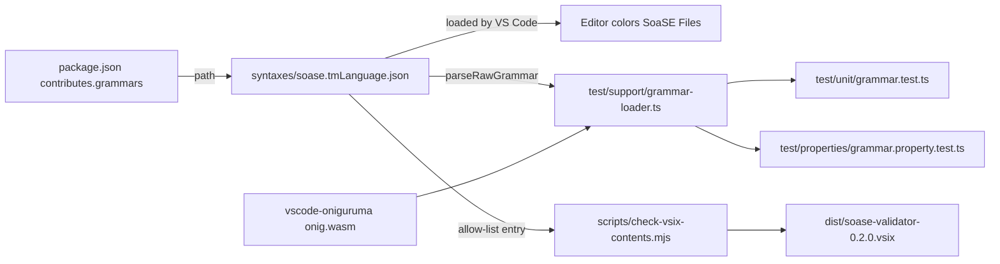

# Design Document

## Overview

The Extension gains one static TextMate grammar for the Language Identifier `soase`. It is a JSON file, `vscode-extension/syntaxes/soase.tmLanguage.json`, registered in the manifest under `contributes.grammars`. The Extension adds no runtime code, no runtime dependency, no setting and no LSP message (Requirement 2.3). The Grammar classifies the Value of each Line by shape: String Value, Number Value, Hex Value, Bool Value or List Value. It colors the Key, and the `=` of the Equals Form.

The work is four pieces:

1. The grammar file and its manifest entry.
2. A test helper that loads the grammar and the oniguruma WebAssembly in plain Node, one unit test and one property test file.
3. One allow-list entry in `scripts/check-vsix-contents.mjs`.
4. The version bump to `0.2.0`, the rebuilt VSIX, and README and steering updates.

### Evidence and verification

The shape rules come from the sources named in `requirements.md` (Reference Root survey, `parser.py` and `tests/test_parser_facts.py`, the plugin notes). This design adds no new shape rule. It turns the Number Value, Hex Value and Bool Value definitions of the glossary into regular expressions. The Reference Root was not re-surveyed for this design. The grammar was prototyped in a temporary directory outside the repository (deleted afterwards) with `vscode-textmate` 9.3.2 and `vscode-oniguruma` 2.0.1 against the snippets listed in Requirement 11 and the edge cases below. Everything marked "Verified" in this document was observed in that run. The property tests are not yet run.

### Design decisions

1. **Flat, line-anchored rules; no `begin`/`end`.** Every top-level rule is a single `match` anchored with `^`. A rule consumes the Key and the Value in one match and names the parts through `captures`. Nothing can open a state, so the rule stack after every Line is the root state (Requirement 2.1, 4.4, 8.4, 8.5).
2. **Rule order is the precedence.** `vscode-textmate` takes the earliest match and, for equal start positions, the first pattern. All rules start at column 0, so list order decides. Number comes before Hex, which implements Requirement 5.3 and 6.3.
3. **Whole-Value classification by lookahead.** Number, Hex and Bool rules end with `(?=[ \t]*$)`. A token followed by more text on the Line fails the rule, so no value Scope Name is assigned (Requirement 5.5). The fallback rule then colors the Key only, and the remaining text matches no rule because every rule begins with `^`.
4. **ASCII character classes only.** Oniguruma runs in UTF-8 mode, where `\d`, `\s` and case-insensitive matching are Unicode aware. In the prototype, `falſe` (U+017F, which case-folds to `s`) matched `(?i:false)`. The rules therefore use `[0-9]`, `[0-9a-fA-F]`, `[eE]`, `[ \t]` and spelled-out `[Tt][Rr][Uu][Ee]` and `[Ff][Aa][Ll][Ss][Ee]`. Only tab and space separate tokens, as Requirement 3.2 states.
5. **The line terminator is excluded explicitly.** `vscode-textmate` appends `\n` to the line it matches. Classes that would otherwise run to the end of the Line use `[^"\n]`, `[^\]\n]` and `[^ \t\n]`.
6. **Key and Value in one rule.** Repeating the Key pattern in each rule is the price of avoiding `begin`/`end`. The test suite guards the repetition (Properties 2 and 7).
7. **Test engine in the dev dependencies only.** `vscode-textmate` and `vscode-oniguruma` are `devDependencies` (Decision 7). They are not in the VSIX, so `THIRD_PARTY_NOTICES.txt` and the production dependency check are unchanged.
8. **No theme contribution.** No `configurationDefaults`, no `tokenColors` (Decision 8). Standard Scope Names let every theme color the file.
9. **Unterminated Equals Form (decided, Decision 9).** `k = "v` is an Equals Form, matching the Engine parser. Rule 1 takes an optional closing quote.
10. **Text after `]` (decided, Decision 10).** It matches no rule, so it has no Scope Name. Hex-only items inside brackets stay uncolored, because a List Value holds Number Value items only, as in the Engine list rule. All classes stay ASCII-only (design decision 4).

## Architecture



VS Code reads the grammar before the Extension activates, without the Server and in untrusted workspaces, because a `grammars` contribution is declarative (Requirement 1.5 to 1.7). The Extension manifest is not asked to start anything for it.

## Components and Interfaces

### Manifest changes (`vscode-extension/package.json`)

```jsonc
"contributes": {
  "languages": [ /* unchanged; same nine extensions */ ],
  "grammars": [
    {
      "language": "soase",
      "scopeName": "source.soase",
      "path": "./syntaxes/soase.tmLanguage.json"
    }
  ]
}
```

- `version` goes from `0.1.0` to `0.2.0`.
- `devDependencies` gains `"vscode-textmate": "^9.3.2"` and `"vscode-oniguruma": "^2.0.1"`.
- The grammar binds to the language, not to file extensions, so Requirement 1.3 and 1.8 hold by construction. The `languages` entry stays byte for byte as it is.
- `.vscodeignore` does not exclude `syntaxes/**`, so no change is needed. The VSIX contains the file, and no other first-party JSON besides `package.json`.

### Scope Names

All names end in `.soase` and follow the TextMate naming conventions, so common themes color them without a theme contribution.

| Category | Scope Name | Used for |
| --- | --- | --- |
| Key | `support.type.property-name.soase` | Key; header Line `TXT`/`TXT2`; comment-looking first run |
| String | `string.quoted.double.soase` | String Value including both quotes |
| Number | `constant.numeric.soase` | Number Value; number items in a List Value |
| Hex | `constant.other.color.soase` | Hex Value |
| Boolean | `constant.language.boolean.soase` | Bool Value |
| Punctuation | `punctuation.definition.list.soase` | `[`, `]` and `,` of a List Value |
| Operator | `keyword.operator.assignment.soase` | `=` of an Equals Form |

All seven are pairwise different (Requirement 3.4, 6.5, 7.5, 9.2). The Grammar defines no comment scope (Requirement 10.1).

### Grammar file

Regular expression pieces (as plain regex; the JSON below holds the escaped form):

| Piece | Regex |
| --- | --- |
| Indentation | `^[ \t]*` |
| Key | `[^ \t\n\[][^ \t\n]*` |
| Number | `[+-]?(?:[0-9]+(?:\.[0-9]*)?\|\.[0-9]+)(?:[eE][+-]?[0-9]+)?` |
| Hex | `[0-9a-fA-F]+` |
| Bool | `[Tt][Rr][Uu][Ee]\|[Ff][Aa][Ll][Ss][Ee]` |
| End of Value | `(?=[ \t]*$)` |

Rules in order (R = top-level `patterns` entry):

1. **Equals Form**: Indentation, Key (capture 1), `[ \t]+`, `=` (capture 2), `[ \t]+`, `"[^"\n]*"?` (capture 3, a terminated or unterminated string; an unterminated one runs to the end of the Line, as in the Engine, Decision 9).
2. **Number**: Indentation, Key (1), `[ \t]+`, Number (2), End of Value.
3. **Hex**: same with Hex. Reached only when Number failed, which implements the precedence.
4. **Bool**: same with Bool.
5. **String**: Indentation, Key (1), `[ \t]+`, `"[^"\n]*"?` (2). The optional closing quote covers the unterminated string (Requirement 4.4). Text after the closing quote matches no rule (Requirement 4.7).
6. **List with Key**: Indentation, Key (1), `[ \t]+`, `\[` (2), `[^\]\n]*` (3, item patterns), `\]?` (4).
7. **Keyless Row**: Indentation, `\[` (1), `[^\]\n]*` (2, item patterns), `\]?` (3). The Key class cannot start with `[`, so rule 8 never colors a Keyless Row.
8. **Key only**: Indentation, Key (1). The fallback for a Key alone, for a Value of no recognised shape, and for the Header Line.

Item patterns (repository `items`, applied only inside the bracket capture): `,` as punctuation, and a Number delimited by `(?<![^ \t,\[])` before and `(?![^ \t,])` after, as number. Inside the capture, a lookbehind sees the `[` and a lookahead ends at the capture end. Verified in the prototype.

```json
{
  "scopeName": "source.soase",
  "name": "SoaSE",
  "patterns": [
    {
      "match": "^[ \\t]*([^ \\t\\n\\[][^ \\t\\n]*)[ \\t]+(=)[ \\t]+(\"[^\"\\n]*\"?)",
      "captures": {
        "1": { "name": "support.type.property-name.soase" },
        "2": { "name": "keyword.operator.assignment.soase" },
        "3": { "name": "string.quoted.double.soase" }
      }
    },
    {
      "match": "^[ \\t]*([^ \\t\\n\\[][^ \\t\\n]*)[ \\t]+([+-]?(?:[0-9]+(?:\\.[0-9]*)?|\\.[0-9]+)(?:[eE][+-]?[0-9]+)?)(?=[ \\t]*$)",
      "captures": {
        "1": { "name": "support.type.property-name.soase" },
        "2": { "name": "constant.numeric.soase" }
      }
    },
    {
      "match": "^[ \\t]*([^ \\t\\n\\[][^ \\t\\n]*)[ \\t]+([0-9a-fA-F]+)(?=[ \\t]*$)",
      "captures": {
        "1": { "name": "support.type.property-name.soase" },
        "2": { "name": "constant.other.color.soase" }
      }
    },
    {
      "match": "^[ \\t]*([^ \\t\\n\\[][^ \\t\\n]*)[ \\t]+([Tt][Rr][Uu][Ee]|[Ff][Aa][Ll][Ss][Ee])(?=[ \\t]*$)",
      "captures": {
        "1": { "name": "support.type.property-name.soase" },
        "2": { "name": "constant.language.boolean.soase" }
      }
    },
    {
      "match": "^[ \\t]*([^ \\t\\n\\[][^ \\t\\n]*)[ \\t]+(\"[^\"\\n]*\"?)",
      "captures": {
        "1": { "name": "support.type.property-name.soase" },
        "2": { "name": "string.quoted.double.soase" }
      }
    },
    {
      "match": "^[ \\t]*([^ \\t\\n\\[][^ \\t\\n]*)[ \\t]+(\\[)([^\\]\\n]*)(\\]?)",
      "captures": {
        "1": { "name": "support.type.property-name.soase" },
        "2": { "name": "punctuation.definition.list.soase" },
        "3": { "patterns": [{ "include": "#items" }] },
        "4": { "name": "punctuation.definition.list.soase" }
      }
    },
    {
      "match": "^[ \\t]*(\\[)([^\\]\\n]*)(\\]?)",
      "captures": {
        "1": { "name": "punctuation.definition.list.soase" },
        "2": { "patterns": [{ "include": "#items" }] },
        "3": { "name": "punctuation.definition.list.soase" }
      }
    },
    {
      "match": "^[ \\t]*([^ \\t\\n\\[][^ \\t\\n]*)",
      "captures": {
        "1": { "name": "support.type.property-name.soase" }
      }
    }
  ],
  "repository": {
    "items": {
      "patterns": [
        { "match": ",", "name": "punctuation.definition.list.soase" },
        {
          "match": "(?<![^ \\t,\\[])[+-]?(?:[0-9]+(?:\\.[0-9]*)?|\\.[0-9]+)(?:[eE][+-]?[0-9]+)?(?![^ \\t,])",
          "name": "constant.numeric.soase"
        }
      ]
    }
  }
}
```

JSON allows no comments, so the rationale lives in this document. The file holds no counts, no file names and no paths (Requirement 12.9).

### Behaviour verified in the prototype

| Line | Result |
| --- | --- |
| `TXT` | Key |
| `  name "a\b'c"` | Key; the quoted text is one String Value |
| `x TRUE`, `x fAlSe` | Boolean |
| `x falſe` | no value scope (Unicode case folding avoided) |
| `x 00000000`, `x 1e5`, `x -1.5`, `x 5.` | Number |
| `x ffFF891D` | Hex |
| `x 1.2.3`, `x 0x10`, `x 5 6` | Key only |
| `  pos [ 1.5 , 2 , x ]` | `[`, `]`, `,` punctuation; `1.5` and `2` numbers; `x` none |
| `[ 0.1 0.2 ]` | Keyless Row, no Key scope |
| `[ 1 2` | items scoped, no state carried |
| `k = "v"` | Key, operator, String |
| `k = "v` | Key, operator, String from the opening quote to the end of the Line |
| `k =` | Key only |
| `[ 1 2 ] x 3` | items and brackets scoped; text after `]` none |
| `k= "v"` | Key `k=`, String; no operator |
| `k ="v"`, `k = 5` | Key only |
| `// c 12` | Key `//`, rest none |
| `x "a\"` | String ends at the quote after the backslash |

### Test helper (`vscode-extension/test/support/grammar-loader.ts`)

The `.mocharc.json` spec globs cover only `out/test/unit/**` and `out/test/properties/**`, so a helper under `test/support/` is compiled by `tsc` (its `include` is `test/**/*.ts`) and is not run as a test file.

```ts
/** Scope data for one character of a Line. */
export interface CharScopes { readonly char: string; readonly scope: string | undefined; }

/** Loads the Grammar named by the manifest once per process. */
export function loadGrammar(): Promise<IGrammar>;

/** Reads package.json and returns the grammars contribution entry for `soase`. */
export function readGrammarContribution(): { language: string; scopeName: string; path: string };

/** Tokenizes one Line from the initial state and returns the leaf scope of every UTF-16 code unit. */
export function scopesOf(grammar: IGrammar, line: string): (string | undefined)[];

/** Tokenizes lines in order, carrying the rule stack, as VS Code does. Returns scopes per line and the stack after each. */
export function tokenizeFile(grammar: IGrammar, lines: readonly string[]): { scopes: (string | undefined)[][]; stacks: StateStack[] };
```

Loading, in plain Node and CommonJS output, with no `vscode` import:

- The package root is `path.resolve(__dirname, '..', '..', '..')` from `out/test/support/`. The manifest is read with `fs.readFileSync` and `JSON.parse`. The grammar path comes from `contributes.grammars` (Requirement 11.1), so the test fails if the manifest points at a missing file.
- The wasm: `fs.readFileSync(require.resolve('vscode-oniguruma/release/onig.wasm'))`. `vscode-oniguruma` 2.0.1 declares no `exports` map, so the sub-path resolves. `loadWASM` accepts an `ArrayBufferView`, so the `Buffer` is passed directly. The promise is stored in a module variable, because the wasm is initialised once per process.
- `new Registry({ onigLib: Promise.resolve({ createOnigScanner, createOnigString }), loadGrammar })`, with `onigLib` built from the two functions `vscode-oniguruma` exports. `loadGrammar('source.soase')` returns `parseRawGrammar(text, path)`.
- `tokenizeLine(line, INITIAL)` returns tokens whose last token can extend past `line.length` because of the appended `\n`. `scopesOf` clips `endIndex` to `line.length`. A character's scope is the last entry of its token's `scopes` when that array has more than one entry (the first is the root `source.soase`), otherwise `undefined`.
- A fresh baseline stack is `grammar.tokenizeLine('', INITIAL).ruleStack`. The stack after a Line is compared to it with `equals`. Comparing with `INITIAL` directly is false even for a plain Line, because `INITIAL` is the null stack and a tokenized Line returns the root-rule stack (observed in the prototype).

Failure reporting (Requirement 11.8): every assertion goes through `expectScope(line, start, end, expected)`, which throws an `assert.AssertionError` whose message holds the snippet text, the expected Scope Name and the actual Scope Name for the first differing character.

### Unit test (`vscode-extension/test/unit/grammar.test.ts`)

Example-based, with synthetic text only (Requirement 11.5). It contains:

- Manifest test: `language` is `soase`, `scopeName` is `source.soase`, the file exists, and the `languages` extension list equals the nine, with no `.manifest` (Requirement 1.1, 1.4, 1.8). It also asserts no `semanticTokenTypes`, `semanticTokenModifiers`, `semanticTokenScopes` or `configurationDefaults` keys, and that `dependencies` lists only `vscode-languageclient` (Requirement 2.3, 2.4, Decision 8).
- Scope table test: the seven Scope Names are pairwise different and the grammar JSON holds no name with `comment` (Requirement 10.1).
- Snippet tests, one `it` each, for the list in Requirement 11.2: quoted string, empty string, string with `'` and `\`, unterminated string, integer, signed decimal, lowercase Hex, uppercase Hex, digits-only token, `TRUE`, `FALSE`, `true`, `True`, comma list, whitespace list, Keyless Row, Equals Form, unterminated Equals Form (`k = "v`).
- Rejected shapes (Requirement 11.3): `'text'`, `1.2.3`, `0x10`, `ffg`, `TRUEX`, `truex`, `[ 1 , x ]`, `key= "v"`, and text after `]` (no Scope Name).
- `//`-prefixed Line (Requirement 11.4), `k ="v"`, `k = 5`, `k =`, `1e5` as number, `"TRUE"` as string, `TXT` and `TXT2` as Key, `TXT` on line 2 as Key.
- Static content test: the grammar JSON text contains no `begin` or `end` property at any depth (Requirement 2.1 design guard).

### Property test (`vscode-extension/test/properties/grammar.property.test.ts`)

Uses `fast-check` with `numRuns: 200`. Each property carries `// Feature: vscode-syntax-highlighting, Property N: <text>`. The test file holds its own independent oracle regular expressions for Number Value and Hex Value, written from the glossary definitions and not copied from the grammar:

```ts
const NUMBER_VALUE = /^[+-]?(?:[0-9]+(?:\.[0-9]*)?|\.[0-9]+)(?:[eE][+-]?[0-9]+)?$/;
const HEX_VALUE = /^[0-9a-fA-F]+$/;
const BOOL_VALUE = /^(?:true|false)$/i;
```

Generators:

| Name | Definition |
| --- | --- |
| `indent` | 0 to 6 characters from tab and space |
| `separator` | 1 to 4 characters from tab and space |
| `key` | one non-space, non-tab character that is not `[`, followed by 0 to 12 non-space, non-tab characters; includes the first-run prefixes `//`, `#`, `;` and a trailing `=` |
| `numberValue` | optional sign, then digits, digits with `.` and optional digits, or `.` and digits, then an optional exponent; any digit count |
| `hexNonNumber` | 1 to 12 characters from `0-9a-fA-F`, filtered by `!NUMBER_VALUE.test` |
| `boolValue` | `true` or `false` with a random case per character |
| `boolNearMiss` | `boolValue` with one character from `[A-Za-z0-9_]` added before or after |
| `stringContent` | `fc.string({ unit: 'binary' })` without `"`, `\n` and `\r` |
| `denseToken` | 1 to 10 characters from `0123456789abcdefABCDEF.+-xgGtTrRuUlLsS_#` filtered so none of `NUMBER_VALUE`, `HEX_VALUE`, `BOOL_VALUE` matches |
| `listItems` | 0 to 6 items, each a `numberValue` or a non-number word, joined by `,` with optional spaces, or by spaces only |
| `anyLine` | one of the line kinds above, an arbitrary string without `\n`, `\r`, or an unterminated string or list |

A Line is `indent + key + separator + value`, and the test knows the character offset of each part, so expectations are exact per character.

## Data Models

The Grammar is data. Its per-Line model, expressed as the partition of a Line into parts:

```
Line        = Indentation, ( KeyedRow | KeylessRow | blank )
KeyedRow    = Key, [ separator, Value-or-rest ]
KeylessRow  = ListText
Value-or-rest = String | Number | Hex | Bool | ListText | EqualsTail | unscoped-rest
EqualsTail  = "=" separator String
ListText    = "[" items-and-delimiters [ "]" ]
```

Scope outcome per part: Indentation, separators, unscoped rest and everything after the closing `]` or closing quote: none. The mapping of each part to a Scope Name is the table above.

### Packaging data

- `scripts/check-vsix-contents.mjs`: a constant `GRAMMAR_FILE = 'syntaxes/soase.tmLanguage.json'`. It is added to `REQUIRED_FILES` (so a missing grammar fails the check) and exempted in `forbiddenReasons` from the first-party JSON rule:

  ```js
  if (firstParty && extension === '.json' && !isPackageManifest(file) && file !== GRAMMAR_FILE) {
  ```

  Every other first-party JSON file, `definitions` directory, game extension and Python file stays rejected (Requirement 12.4, Decision 6). The entry is an exact path match, not a directory or pattern, so a second JSON file in `syntaxes/` is still rejected, which backs Requirement 12.3. The check does not read the manifest path, so a manifest path that differs from `GRAMMAR_FILE` fails as a missing required file.
- Version: `npm version --no-git-tag-version minor` in `vscode-extension/` changes `version` in `package.json` and both entries in `package-lock.json` (the root `version` and `packages[""].version`) from `0.1.0` to `0.2.0` (Requirement 12.1). `npm run package` writes `dist/soase-validator-0.2.0.vsix`. The script writes only the name derived from the current version, so the existing `dist/soase-validator-0.1.0.vsix` is untouched (Requirement 12.2).

### Dependency versions

Checked on the npm registry when this design was written:

| Package | Latest | Chosen range | Role and note |
| --- | --- | --- | --- |
| `vscode-textmate` | 9.3.2 | `^9.3.2` | dev; grammar interpreter for the tests; MIT; no dependencies; CommonJS `release/main.js` with `types/vscode-textmate.d.ts` |
| `vscode-oniguruma` | 2.0.1 | `^2.0.1` | dev; oniguruma as WebAssembly; MIT; no dependencies; `release/main.js`, `release/onig.wasm`, `main.d.ts`; no `exports` map |

An isolated install of both packages in a temporary directory reported 0 vulnerabilities from `npm audit`. The audit in the real project runs after `npm install` (`npm run audit` uses `--audit-level=high`) and its result goes in the task summary. Both are CommonJS, so they load under `module: node16` without `type: module`. They are dev dependencies, so `listProductionDependencies` and `THIRD_PARTY_NOTICES.txt` do not change.

The dependency table in `.kiro/specs/vscode-extension/design.md` and the library list in `.kiro/steering/tech.md` ("Dev tooling is ...") gain the two packages in the same change.

## Correctness Properties

*A property is a characteristic or behavior that should hold true across all valid executions of a system-essentially, a formal statement about what the system should do. Properties serve as the bridge between human-readable specifications and machine-verifiable correctness guarantees.*

Reflection: the criteria for single-line dependence (2.1, 4.4, 8.4, 8.5) are one property. The Key criteria (3.1, 3.2, 3.3, 3.5, 3.6, 3.7, 10.2) are one property. The per-shape criteria stay separate, because each needs its own generator. Hex and Bool near-miss criteria (6.6, 7.2, 5.4, 5.5) collapse into one rejection property. Criteria that restate a property (6.3, 7.4, 4.5) become examples in the unit test.

### Property 1: Grammar scopes depend only on a single line

For any sequence of Lines of any kind (valid, unterminated string, unterminated list, arbitrary text), tokenizing the sequence in order with the rule stack carried between Lines gives, for every Line, the same scopes as tokenizing that Line alone from the initial state, and the rule stack after every Line equals the stack after an empty Line.

**Validates: Requirements 2.1, 4.4, 8.4, 8.5**

### Property 2: A Value's scope does not depend on its Key

For any two Keys and any Value of any shape (String, Number, Hex, Bool, List), the scopes of the Value's characters are identical in `Key1 Value`, `Key2 Value` and the Equals Form tail where applicable.

**Validates: Requirements 2.2, 4.8**

### Property 3: The Key span is exact

For any Indentation, any Key (including Keys that begin with `//`, `#` or `;`, contain `=`, `"` or `'`), and any text after a separator, exactly the characters of the Key carry the key Scope Name, and Indentation, separator and the text after it carry none.

**Validates: Requirements 3.1, 3.2, 3.3, 3.5, 3.6, 3.7, 10.2**

### Property 4: String spans are exact

For any String content without `"`, `\n` and `\r`, in `Key "content"` with any trailing text after the closing quote, every character from the opening quote through the closing quote has the string Scope Name, no other character has it, and the trailing text has no value Scope Name. Without the closing quote, the string Scope Name covers the opening quote through the last character of the Line.

**Validates: Requirements 4.1, 4.2, 4.3, 4.4, 4.6, 4.7**

### Property 5: Number Values get the number scope

For any Number Value (any sign, integer, decimal with a trailing or leading point, any exponent, any number of digits), `Key Value` with optional trailing whitespace gives every character of the Value the number Scope Name and the trailing whitespace none.

**Validates: Requirements 5.1, 5.2, 5.3, 5.6, 6.3**

### Property 6: Hex Values that are not numbers get the hex scope

For any string of one or more characters from `0-9a-fA-F` that is not a Number Value, `Key Value` gives every character of the Value the hex Scope Name.

**Validates: Requirements 6.1, 6.2, 6.4, 6.7**

### Property 7: Booleans in any capitalization get the boolean scope

For any capitalization of `true` or `false`, `Key Value` gives every character of the Value the boolean Scope Name.

**Validates: Requirements 7.1, 7.3**

### Property 8: Tokens of no value shape get no value scope

For any non-whitespace token that is not a Number Value, Hex Value or Bool Value and does not begin with `"` or `[` (including a Bool Value with one extra character, `1.2.3`, `0x10`, `ffg`, `#ffffff` and `=`-led tokens), `Key token` gives no character of the token any value Scope Name. For any Number Value followed by a space and a further non-whitespace character, the Value also gets none.

**Validates: Requirements 5.4, 5.5, 6.6, 7.2, 9.4**

### Property 9: List items and delimiters

For any list of items separated by commas (with optional spaces) or by whitespace only, with or without `]`, in a Keyed or Keyless Row, each Number Value item has the number Scope Name, `[`, `]` and each `,` have the punctuation Scope Name, non-number items and whitespace have none, and a Keyless Row has no key Scope Name on any character.

Any text after the first `]` has no Scope Name.

**Validates: Requirements 8.1, 8.2, 8.3, 8.6, 8.7**

### Property 10: Equals Form operator

For any Key, any separators of tabs and spaces, and any String content without `"`, `\n` and `\r`, `Key sep = sep "content"` and the unterminated `Key sep = sep "content` give the Key the key scope, only the `=` the operator Scope Name, and the quoted text (to the closing quote, or to the end of the Line when unterminated) the string Scope Name. With no separator between Key and `=`, the `=` belongs to the Key and no character has the operator Scope Name.

**Validates: Requirements 4.8, 9.1, 9.2, 9.3, 9.5**

## Error Handling

A grammar has no runtime errors of its own. The relevant failure modes:

- **Invalid grammar JSON or regex.** VS Code ignores a broken grammar silently and the file appears uncolored. The unit test loads the grammar through `vscode-textmate` and `oniguruma`, so an invalid pattern fails `npm run test`.
- **Missing grammar file or wrong manifest path.** The unit test resolves the manifest path (Requirement 11.1). The contents check lists the grammar as required.
- **Unmatched or malformed text.** Never an error. A Line of unknown shape gets the Key only, or nothing (Requirement 5.4). Validity belongs to the Server.
- **Test failures.** An assertion failure reports the snippet, the expected and the actual Scope Name (Requirement 11.8). `fast-check` also prints the shrunk counterexample.
- **wasm load failure in the helper.** The helper rejects with the underlying error and the missing path, so a missing `vscode-oniguruma` install fails with a clear message. The first `loadGrammar` call stores the promise, and later calls reuse it.

## Testing Strategy

Property-based testing applies: the Grammar is a pure function from one Line to a scope assignment, and the Number, Hex, Bool and String shapes are large input spaces. Manifest, packaging and documentation criteria are examples or smoke checks.

- **Unit tests** (`test/unit/grammar.test.ts`): the examples listed above, including every snippet and rejected shape of Requirement 11.
- **Property tests** (`test/properties/grammar.property.test.ts`): Properties 1 to 10, each as a single `fast-check` property with `numRuns: 200` (the minimum is 100), tagged `// Feature: vscode-syntax-highlighting, Property N: <text>`. The oracle regular expressions in the test file come from the glossary, not from the grammar.
- **Library**: `fast-check` `^4.10.2`, already installed. No property framework is written from scratch.
- **Tooling constraints**: the tests import no `vscode`, start no Server, use no network, read no Reference Root and embed no game text (Requirement 11.5, 11.6). Both files compile with `tsc`, pass `eslint` with the existing type-checked rules and run under `mocha` through the existing `.mocharc.json` globs. `test/unit/` holds no file yet in this repository state, so these two tests are the first ones mocha finds there; no `.mocharc.json` change is needed.
- **Packaging checks**: after the change, `npm run compile`, `npm run lint`, `npm run test` and `npm run package` run in `vscode-extension/` (Requirement 12.5). The check of the allow-list in Requirement 12.4 is verified by hand once: add a second JSON file under `syntaxes/` (or under another first-party folder), run `node node_modules/@vscode/vsce/vsce ls | node scripts/check-vsix-contents.mjs`, observe the non-zero exit and the named file, and remove the file. `vsce ls` of the real tree must list `syntaxes/soase.tmLanguage.json` exactly once and exit 0.
- **Host tests**: unchanged. The grammar is declarative; the host suite does not exercise coloring.
- **Manual check**: open a sample `.entity` file in VS Code with the Server stopped, and use "Developer: Inspect Editor Tokens and Scopes" to confirm one token per category. This is not automated.

### Documentation and steering updates

- `vscode-extension/README.md`: a "Syntax coloring" section naming the six categories (key, string, number, hex color, boolean, list punctuation) and the `=` operator, stating that coloring follows token shape only, that Definition-aware coloring is not provided, that coloring works without the Server, and that booleans are matched in any capitalization although the Server reports lowercase ones (Requirement 12.7). The "Supported files" section stays as is.
- Project `README.md`: remove the "Syntax coloring for the supported file types in code editors." bullet from the planned list, and state syntax coloring in the VS Code section (Requirement 12.6).
- `.kiro/steering/structure.md`: add `syntaxes/  # soase.tmLanguage.json, the contributed TextMate grammar` and `test/support/` to the `vscode-extension/` tree (Requirement 12.8).
- `.kiro/steering/tech.md`: add `vscode-textmate` and `vscode-oniguruma` to the extension dev tooling list. This is a steering change that the user may want to review.
- `.kiro/specs/vscode-extension/design.md`: add the two rows to the dependency table.
